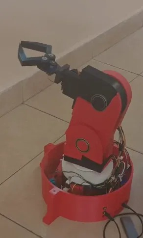
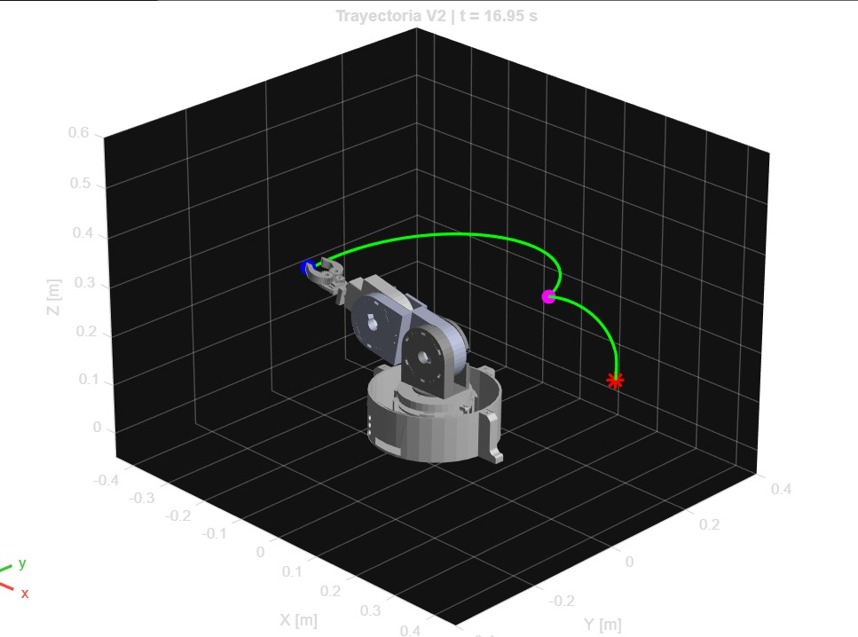

# Robot 1 — Manipulador para la transferencia de aceite

<p align="center">
  <strong>Manipulador articulado de 4 grados de libertad más pinza</strong>
</p>

<p align="center">
  <em>Diseño, modelado, simulación y control de un manipulador robótico para una línea automatizada de producción y envasado de aceite.</em>
</p>

---

## Descripción del proyecto

El Robot 1 es un manipulador diseñado para tomar un recipiente con aceite, trasladarlo, inclinarlo para verter su contenido y regresar a una posición segura.

Corresponde a la primera estación de una línea robotizada de producción y envasado de aceite compuesta por cinco robots.

El proyecto integra diseño mecánico, modelado cinemático, generación de trayectorias, simulación y control mediante ROS 2 y un microcontrolador ESP32.

---

## Contenido

- [Imagenes/](./Imagenes/)
- [Documentacion/](./Documentacion/)
- [Piezas_Robot/](./Piezas_Robot/)
- [Calculos_Matlab/](./Calculos_Matlab/)
- [Trayectorias/](./Trayectorias/)
- [ROS_2/](./ROS_2/)
- [ESP32/](./ESP32/)
- [GUI/](./GUI/)
- [Ejecucion_Comandos/](./Ejecucion_Comandos/)
- [ANALISIS_CONTEXTO.pdf](./ANALISIS_CONTEXTO.pdf)

---

## Estado del proyecto

El robot ha tenido dos versiones. La primera permitió validar la metodología de diseño, cinemática, trayectorias y control. La segunda reemplaza la transmisión inicial por un sistema de engranajes y constituye la versión implementada. En este depositorio se encontrara el proceso de la version final.

### Comparación entre versiones

| Característica | Versión 1 | Versión 2 (actual) |
|:---|:---|:---|
| Apariencia | Negro, brazo largo con correas | Rojo, compacto, base cilíndrica |
| Transmisión | Poleas y correa | Engranajes |
| Cinemática | Desarrollada y validada | Adaptada a la nueva geometría |
| Trayectorias | Generación y simulación | Generación y ejecución mediante ROS 2 |
| Estado | Fabricada; base metodológica | Ensamblada y puesta en funcionamiento; proceso individual ejecutado mediante ROS 2 |

### Ensamblaje completo

<p align="center">
  
</p>

<p align="center">
  <em>Ensamblaje completo del manipulador Robot 1.</em>
</p>

---

## Función dentro de la planta

La línea de producción ocupa un área de **1,25 m × 1,25 m** y está compuesta por cinco estaciones robotizadas.

### Distribución de funciones

| Robot | Etapa del proceso |
|:---:|:---|
| **Robot 1** | Transferencia de aceite del tanque inicial al tanque de enfriamiento |
| Robot 2 | Posicionamiento del envase y llenado |
| Robot 3 | Transporte del envase lleno a la estación de tapado |
| Robot 4 | Tapado |
| Robot 5 | Distribución final |

### Secuencia de operación del Robot 1

1. Parte de la posición HOME.
2. Se aproxima al recipiente (punto A).
3. Sujeta el recipiente mediante la pinza.
4. Eleva y recoge el recipiente.
5. Gira y extiende el brazo hacia el punto de vertido (punto B).
6. Gira la muñeca (`joint_4`) para inclinar el recipiente.
7. Deshace el giro y regresa a HOME.

---

## Especificaciones técnicas

| Característica | Valor |
|:---|:---|
| Grados de libertad | 4 articulaciones rotacionales + pinza |
| Efector final | Pinza accionada por servo |
| Fabricación | Piezas impresas en 3D |
| Diseño mecánico | SolidWorks |
| Transmisión | Engranajes |
| Controlador | ESP32 |
| Actuadores | Motores DC con encoder y servos |
| Posición HOME | `joint_1 = 0°`, `joint_2 = 0°`, `joint_3 = −180°`, `joint_4 = 0°` |
| Distancia de agarre | 92,67 mm desde el origen de `4_Link` |
| Software | ROS 2, Gazebo, RViz y MATLAB |

### Articulaciones y límites de movimiento

| Articulación | Función | Rango |
|:---|:---|:---:|
| `joint_1` | Giro de la base | −180° a 180° |
| `joint_2` | Elevación del brazo | −90° a 90° |
| `joint_3` | Flexión del codo | −185° a 11,5° |
| `joint_4` | Orientación de la muñeca | −150° a 90° |

---

## Estructura del repositorio

  - [Documentacion/](./Documentacion/)
  - [Piezas_Robot/](./Piezas_Robot/)
  - [Calculos_Matlab/](./Calculos_Matlab/)
  - [Trayectorias/](./Trayectorias/)
  - [ROS_2/](./ROS_2/)
  - [ESP32/](./ESP32/)
  - [GUI/](./GUI/)
  - [Ejecucion_Comandos/](./Ejecucion_Comandos/)
  - [ANALISIS_CONTEXTO.pdf](./ANALISIS_CONTEXTO.pdf)

### Descripción de las carpetas

| Carpeta | Contenido |
|:---|:---|
| `Documentacion/` | Documentación adicional del proyecto, Diagramas de planta, proceso e informes técnicos. |
| `Piezas_Robot/` | Modelos CAD, piezas STEP y archivos del robot. |
| `Calculos_Matlab/` | Cinemática directa, inversa y generación de trayectorias. |
| `Trayectorias/` | Archivos CSV de trayectorias articulares y cartesianas. |
| `ROS_2/` | Espacio de trabajo ROS 2, URDF, controladores y scripts. |
| `ESP32/` | Firmware y configuración del microcontrolador. |
| `GUI/` | Interfaz gráfica de monitoreo. |
| `Ejecucion_Comandos/` | Guías de ejecución y comandos. |


---

## Flujo de trabajo

El desarrollo del manipulador integra herramientas de diseño, análisis, simulación y control.

```text
                 SOLIDWORKS
              Diseño mecánico CAD
                      │
                      ▼
                 URDF + STL
              Modelo del robot
                      │
                      ▼
                   MATLAB
          Cinemática y planeación
                de trayectorias
                      │
                      ▼
              ARCHIVOS CSV
           Trayectorias articulares
               y cartesianas
                      │
                      ▼
                   ROS 2
               arm_controller
                      │
                      ▼
               GAZEBO / RVIZ
                  Validación
                      │
                      ▼
           COMUNICACIÓN SERIAL USB
                      │
                      ▼
                   ESP32
              Control de actuadores
                      │
                      ▼
              MOTORES Y SERVOS
```

El modelo mecánico se exporta desde SolidWorks y se utiliza para desarrollar la cinemática y las trayectorias en MATLAB.

Posteriormente, los archivos de trayectoria se ejecutan mediante ROS 2, permitiendo realizar la validación individual del manipulador.

---

## Modelo cinemático

## Modelo cinemático

Para el posicionamiento del extremo se desacopla `θ4`, que solo orienta la herramienta, y se trabaja con un modelo equivalente de 3 GDL con `d1 = 0,200 m`, `a2 = 0,150 m` y `a3 = 0,150 m` (ver [`COMPARACION_CINEMATICA_INVERSA_DIRECTA.pdf`](./Diagramas/COMPARACION_CINEMATICA_INVERSA_DIRECTA.pdf)).

### Parámetros geométricos

| Parámetro | Descripción | Valor |
|:---:|:---|:---:|
| `d1` | Altura de la base | 0,200 m |
| `a2` | Longitud del segundo eslabón | 0,150 m |
| `a3` | Longitud del tercer eslabón | 0,150 m |

****Cinemática directa****

```text

r = a2·cos(θ2) + a3·cos(θ2 + θ3)

X = r·cos(θ1)

Y = r·sin(θ1)

Z = d1 + a2·sin(θ2) + a3·sin(θ2 + θ3)

```

****Cinemática inversa**** (codo abajo)

```text

θ1 = atan2(Y, X)

r  = √(X² + Y²),   s = Z − d1

D  = (r² + s² − a2² − a3²) / (2·a2·a3)

θ3 = atan2(−√(1 − D²), D)

θ2 = atan2(s, r) − atan2(a3·sin θ3, a2 + a3·cos θ3)

```

****Jacobiano.**** Para el seguimiento cartesiano se usó control cinemático con la pseudoinversa del Jacobiano geométrico:

```text

q̇ = J†(q) · (v_ff + Kp·e)        q(k+1) = q(k) + q̇·Δt

```
En la validación de una trayectoria por Jacobiano inverso (versión 1, en simulación) el error máximo fue de unos 0,48 mm y la velocidad articular máxima de unos 8,9 °/s. Estos valores no son una validación del robot físico V2.

En MATLAB se desarrollaron los cálculos de cinemática directa e inversa y la generación de trayectorias para el manipulador.

---

## Trayectoria de referencia

La trayectoria de demostración corresponde a la secuencia:

<p align="center">
  <strong>HOME → A → B → VERTIDO → HOME</strong>
</p>

### Representación de la trayectoria

<p align="center">
  
</p>

### Fases de movimiento

| Fase | Movimiento | Duración |
|:---:|:---|:---:|
| 1 | HOME → Punto A | 8 s |
| 2 | A → B | 17 s |
| 3 | Giro de `joint_4` para el vertido | 5 s |
| 4 | Recuperación de orientación | 5 s |
| 5 | Regreso a HOME | 10 s |

### Puntos de trabajo

| Punto | X (m) | Y (m) | Z (m) |
|:---:|:---:|:---:|:---:|
| A | 0,28 | 0,19 | 0,16 |
| B | −0,34 | 0 | 0,25 |

La trayectoria contempla el posicionamiento inicial, el agarre del recipiente, el desplazamiento hacia el punto de vertido y el retorno a la posición inicial.

---

##  Electrónica y control

El sistema electrónico utiliza un ESP32 como unidad de control para gestionar los actuadores y recibir las referencias articulares mediante comunicación serial.

### Componentes principales

| Elemento | Descripción |
|:---|:---|
| Microcontrolador | ESP32 |
| Motores | Motores DC con encoder |
| Driver | L298N |
| Realimentación | Encoders incrementales |
| Control | PID de posición |
| Servos | MG996R y SG90 |
| Alimentación | Regulador LM2596 |
| Comunicación | Puerto serial USB |
| Velocidad serial | 115200 baudios |

### Correspondencia entre articulaciones y actuadores

| Articulación ROS 2 | Actuador | IN1 | IN2 | PWM | Encoder |
|:---|:---|:---:|:---:|:---:|:---:|
| `joint_1` | Motor BASE | 25 | 26 | 27 | 32 |
| `joint_2` | Motor CODO | 19 | 21 | 18 | 34 |
| `joint_3` | Motor HOMBRO | 2 | 4 | 15 | 23 |
| `joint_4` | Servo MG996R | — | — | GPIO 12 | — |
| Pinza | Servo SG90 | — | — | GPIO 13 | — |

El firmware recibe las referencias articulares mediante comunicación serial y ejecuta el control de los actuadores.

---

## Ejecución del proyecto

El entorno de simulación utiliza **ROS 2 Jazzy**.

### 1. Preparación del entorno

Abrir una terminal en el entorno de ROS 2 y cargar las configuraciones:

```bash
source /opt/ros/jazzy/setup.bash

source ~/robot2_ws/install/setup.bash
```

### 2. Verificación de la trayectoria

Antes de ejecutar el movimiento, se puede comprobar la trayectoria mediante:

```bash
python3 ~/robot2_ws/scripts/ejecutar_trayectoria.py --check
```

### 3. Ejecución de la trayectoria

Para ejecutar la trayectoria:

```bash
python3 ~/robot2_ws/scripts/ejecutar_trayectoria.py --run
```

El procedimiento completo de ejecución, incluyendo la preparación de Gazebo, los controladores y la comunicación con el robot, se encuentra en la carpeta:

```text
Ejecucion_Comandos/
```

---

## Seguridad

Antes de ejecutar cualquier movimiento del manipulador, se deben verificar las siguientes condiciones:

- Verificar los límites articulares antes de ejecutar movimientos.
- Comprobar las conexiones eléctricas y la alimentación de los motores.
- Mantener accesible el corte físico de potencia.
- Confirmar la posición HOME antes de establecer el cero lógico.
- Evitar abrir el puerto serial desde dos programas simultáneamente.
- Verificar que el área de movimiento esté despejada antes de ejecutar las trayectorias.

---

## Documentación

El repositorio incluye documentos relacionados con el análisis, diseño y validación del proyecto.

| Documento | Descripción |
|:---|:---|
| `ANALISIS_CONTEXTO.pdf` | Contexto y distribución de funciones de los cinco robots. |
| `CARTILLA_SEGUNDO_CORTE.pdf` | Proceso de diseño, modelado y validación. |
| `PLANEACION_DE_TRAYECTORIAS_PRIMERA_VERSION.pdf` | Planeación de trayectorias. |
| `VALIDACION_TRAYECTORIA.pdf` | Validación de trayectorias. |
| `COMPARACION_CINEMATICA_INVERSA_DIRECTA.pdf` | Comparación de cinemática directa e inversa. |

---

## Equipo de trabajo

| Integrante |
|:---|
| Jaider Hernández |
| Santiago Pinzón |
| Mariana Rodríguez |
| Kevin Ruiz |

### Información académica

| Campo | Información |
|:---|:---|
| Asignatura | Robótica |
| Programa | Ingeniería Mecatrónica |
| Universidad | Universidad Militar Nueva Granada |
| Docente | Nelson Velasco |

---

<p align="center">
  <strong>Universidad Militar Nueva Granada</strong>
  <br>
  Ingeniería Mecatrónica — Robótica
  <br>
  <em>Robot 1: Manipulador para la transferencia de aceite</em>
</p>