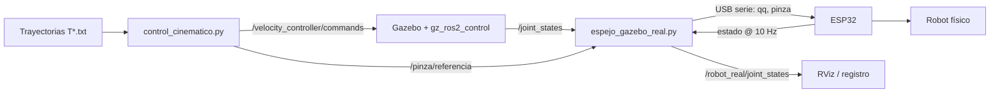

# Robot_2 · Manipulador SCARA RRP

## Integrantes
- Jaime Estupiñán
- Sebastián Landínez
- Andrés Bustos

## Descripción general

Manipulador robótico tipo SCARA de tres grados de libertad (dos juntas rotacionales y una prismática vertical) con pinza accionada por servo. En la línea de producción de aceites, el robot recoge envases vacíos, los ubica bajo la válvula de llenado y los entrega a la siguiente estación.

El proyecto tiene dos partes que trabajan juntas:

- **Gemelo digital:** el robot en ROS 2 y Gazebo (paquete `Robrot_description`). Ahí se ejecutan las trayectorias con un control cinemático que limita la velocidad de cada junta.
- **Robot físico:** un ESP32 controla los tres motores DC con encoder y el servo de la pinza (firmware `scara_verificacion.ino`). El nodo espejo le envía la pose de Gazebo, así que el robot real repite lo que hace la simulación.



## Datos principales del prototipo

| Elemento | Valor |
|---|---|
| Brazo 1 (L1) | 120 mm |
| Brazo 2 (L2) | 188.6 mm |
| Carrera vertical (d3) | 0 a 85 mm (punta entre 162 y 247 mm sobre la mesa) |
| Alcance | 68.6 a 308.6 mm |
| Velocidad máxima de las juntas rotacionales | 0.20 rad/s |
| Velocidad máxima de la junta prismática | 0.15 m/s |
| Pinza | Servo: 25° cerrada, 145° abierta |
| Electrónica | ESP32 DevKit, drivers BTS7960, fuente de 24 V, finales de carrera en los 3 ejes |

## Requisitos

- Ubuntu con ROS 2. El sistema se probó con **ROS 2 Lyrical** y Gazebo (gz sim) en Ubuntu con Python 3.14. El paquete también declara compatibilidad con Jazzy + Gazebo Harmonic, pero en una máquina con Python 3.14 hay que usar Lyrical.
- Paquetes de ROS: `xacro`, `robot_state_publisher`, `rviz2`, `ros2_control`, `ros2_controllers`, `ros_gz` y `gz_ros2_control`.
- `colcon`, `git` y `python3-serial` (para el robot físico).
- Arduino IDE con soporte para ESP32 (placa DOIT ESP32 DEVKIT V1), solo si se va a cargar el firmware.

La instalación completa, paso a paso, está en el [manual de usuario](documentacion/manual_usuario/README.md).

## Inicio rápido

```bash
# 1. Copiar el paquete a un espacio de trabajo y compilar
mkdir -p ~/ros2_ws/src
cp -r codigo_fuente/ros2/Robrot_description ~/ros2_ws/src/
cd ~/ros2_ws
source /opt/ros/lyrical/setup.bash
colcon build --packages-select Robrot_description
source install/setup.bash

# 2. Simulación en Gazebo (terminal 1)
ros2 launch Robrot_description gazebo.launch.py

# 3. Control cinemático con una trayectoria (terminal 2)
ros2 run Robrot_description control_cinematico.py --ros-args -p use_sim_time:=true -p trayectoria:=T4
```

Para que el robot físico copie la simulación, abre una terminal más **antes** del paso 3:

```bash
python3 codigo_fuente/ros2/herramientas/espejo_gazebo_real.py --ros-args -p puerto:=/dev/ttyUSB0
```

Espera el mensaje `Siguiendo a Gazebo.` y luego lanza el control.

## Estructura del proyecto

```text
Robot_2/
├── codigo_fuente/
│   ├── ros2/
│   │   ├── Robrot_description/        Paquete actual: URDF, Gazebo, control cinemático, trayectorias
│   │   ├── herramientas/
│   │   │   └── espejo_gazebo_real.py  Envía la pose de Gazebo al robot físico
│   │   └── Scara_Final_description/   Versión anterior del modelo (ya no se usa)
│   └── microcontrolador/
│       └── scara_verificacion/        Firmware del ESP32, visor web y guía de calibración
└── documentacion/
    ├── arquitectura/                  Componentes, nodos, tópicos y hardware
    ├── diagramas_secuencia/           Arranque, ciclo de trayectoria y enlace con el robot
    ├── memorias_calculo/              Cinemática, Jacobiano, límites y control
    ├── manual_usuario/                Instalación, operación y solución de problemas
    └── Planos/                        Dimensiones y espacio para los planos
```

## Documentación técnica

| Documento | Contenido |
|---|---|
| [Arquitectura](documentacion/arquitectura/README.md) | Componentes de software y hardware, nodos, tópicos y orden de las juntas |
| [Diagramas de secuencia](documentacion/diagramas_secuencia/README.md) | Arranque del sistema, home del ESP32, ciclo de cada trayectoria y eventos de la pinza |
| [Memorias de cálculo](documentacion/memorias_calculo/README.md) | Cinemática directa e inversa, Jacobiano, conversión modelo–firmware, límites y ley de control |
| [Manual de usuario](documentacion/manual_usuario/README.md) | Instalación, ejecución en Gazebo y en el robot físico, y solución de problemas |
| [Planos](documentacion/Planos/README.md) | Dimensiones del prototipo |
| [Cambios del paquete](codigo_fuente/ros2/Robrot_description/LEEME_CAMBIOS.md) | Correcciones del modelo, puente con el robot real y calibración |
| [Guía de verificación del firmware](codigo_fuente/microcontrolador/scara_verificacion/GUIA_VERIFICACION.md) | Home, sentido de giro y calibración en el ESP32 |

## Pruebas y resultados

Al final se probaron con Gazebo y con el montaje físico las trayectorias **T1, T4, T7, T8 y T19**. Cada archivo dura 3 s y pide más velocidad de la permitida, así que el control estira el tiempo lo necesario para no pasar de 0.20 rad/s:

| Trayectoria | q1 inicial → final | Velocidad máx. original de q1 | Factor de tiempo | Duración |
|---|---|---|---|---|
| T1 | 0° → 28.6° | 0.33 rad/s | 1.65 | 4.93 s |
| T4 | 0° → 37.2° | 0.43 rad/s | 2.15 | 6.43 s |
| T7 | 0° → 45.8° | 0.53 rad/s | 2.65 | 7.92 s |
| T8 | −40° → 8.7° | 0.57 rad/s | 2.83 | 8.45 s |
| T19 | −40° → 40.2° | 0.93 rad/s | 4.65 | 13.90 s |

Eventos de la pinza: al terminar **T4** se abre y se cierra a los **2 s**; al terminar **T7**, a los **3 s**.

Problemas resueltos durante la integración (detalle en las [memorias de cálculo](documentacion/memorias_calculo/README.md#7-correcciones-al-modelo) y en el [manual](documentacion/manual_usuario/README.md#7-solución-de-problemas)):

- El modelo exportado del CAD aparecía acostado y los brazos giraban sobre puntos equivocados.
- Los controladores no cargaban por nombres repetidos en `ros2_control` y un YAML anidado.
- En Gazebo las juntas arrancaban fuera de sus límites y quedaban bloqueadas.
- El ESP32 se reinicia al abrir el puerto USB y pierde el home; el nodo espejo espera su arranque y repite el home.

**Limitaciones:**

- T7 llega a 45.8°, a solo 0.3° del final de carrera del hombro.
- La singularidad del codo (θ2 = 0°, brazo estirado) está dentro de su rango; T19 termina cerca de ella.
- Con el límite de 0.20 rad/s, las trayectorias tardan entre 1.65 y 4.65 veces más que en el archivo original.

## Contribuciones y reutilización

Este proyecto tiene fines académicos. Al modificarlo, mantén la estructura de carpetas, documenta los cambios en `LEEME_CAMBIOS.md` y verifica el entorno antes de ejecutar el código. Antes de mover el robot físico, revisa que no haya nada en su camino y ten a mano el botón **BOOT** del ESP32 para detenerlo.

---

**Laboratorio de Robótica | Universidad Militar Nueva Granada | Diseño, simulación y control de un manipulador SCARA.**
