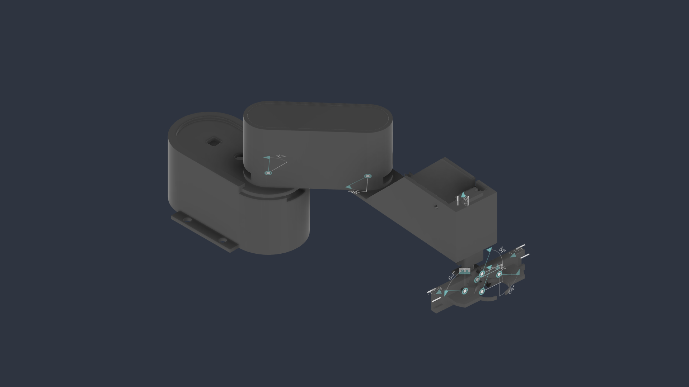

# Robrot — Robot Description

> **Modelo corregido** (prismático invertido, pinza funcional, conexión con el robot real y uso desde otra computadora): ver [LEEME_CAMBIOS.md](LEEME_CAMBIOS.md). Las tablas de abajo son del export original de Fusion.




## Overview

| Property | Value |
|----------|-------|
| Total mass | 7.398 kg |
| Links | 10 |
| Joints | 9 (8 movable) |
| Assemblies | 3 |
| Root link | `base_link` |

## Table of Contents

- [Kinematic Tree](#kinematic-tree)
- [Link Properties](#link-properties)
- [Joint Properties](#joint-properties)
- [Assembly Breakdown](#assembly-breakdown)
- [Quick Start (ROS 2)](#quick-start-ros-2)
- [Files](#files)

## Kinematic Tree

```
base_link [BAKE]
  └─ Revoluci_n_6 [revolute]
    Brazo1_Unido [BAKE]
      └─ Revoluci_n_7 [revolute]
        Brazo_2 [BAKE]
          └─ Corredera_9 [prismatic]
            Cremallera2 [BAKE]
              └─ R_gida_11 [fixed]
                carril
                  └─ Revoluci_n_12 [revolute]
                    union [BAKE]
                  └─ Corredera_13 [prismatic]
                    Robrot_grip [BAKE]
                      └─ Revoluci_n_15 [continuous]
                        Robrot_guarda_2 [BAKE]
                  └─ Corredera_14 [prismatic]
                    Robrot_grip_2 [BAKE]
                      └─ Revoluci_n_17 [continuous]
                        Robrot_guarda [BAKE]
```

## Link Properties

| Link | Mass (kg) | Material | Collision | Bodies |
|------|-----------|----------|-----------|--------|
| `Brazo1_Unido` | 2.0064 | Acero | box | 1 |
| `Brazo_2` | 1.5980 | Acero | box | 1 |
| `Cremallera2` | 0.3769 | Acero | box | 1 |
| `Robrot_grip` | 0.0551 | Acero | cylinder | 1 |
| `Robrot_grip_2` | 0.0551 | Acero | cylinder | 1 |
| `Robrot_guarda` | 0.0086 | Acero | cylinder | 1 |
| `Robrot_guarda_2` | 0.0086 | Acero | cylinder | 1 |
| `base_link` | 3.1167 | Acero | box | 2 |
| `carril` | 0.1645 | Acero | box | 1 |
| `union` | 0.0079 | Acero | box | 1 |

## Joint Properties

| Joint | Type | Parent → Child | Axis | Limits |
|-------|------|---------------|------|--------|
| `Corredera_13` | prismatic | `carril` → `Robrot_grip` | (1,0,0) | — |
| `Corredera_14` | prismatic | `carril` → `Robrot_grip_2` | (-1,0,0) | — |
| `Corredera_9` | prismatic | `Brazo_2` → `Cremallera2` | (-1,0,0) | [5.0, 23.0] mm |
| `R_gida_11` | fixed | `Cremallera2` → `carril` | (0,0,1) | — |
| `Revoluci_n_12` | revolute | `carril` → `union` | (0,0,1) | [0.0°, 90.0°] |
| `Revoluci_n_15` | continuous | `Robrot_grip` → `Robrot_guarda_2` | (0,0,1) | — |
| `Revoluci_n_17` | continuous | `Robrot_grip_2` → `Robrot_guarda` | (0,0,1) | — |
| `Revoluci_n_6` | revolute | `base_link` → `Brazo1_Unido` | (0,0,1) | [-90.0°, 90.0°] |
| `Revoluci_n_7` | revolute | `Brazo1_Unido` → `Brazo_2` | (0,0,1) | [-90.0°, 90.0°] |

## Assembly Breakdown

### Brazo1_Unido

- **Links**: Brazo1_Unido
- **Total mass**: 2.006 kg

### Robrot

- **Links**: Brazo_2, Cremallera2, carril, union, Robrot_grip, Robrot_grip_2, Robrot_guarda, Robrot_guarda_2
- **Total mass**: 2.275 kg

### base_link

- **Links**: base_link
- **Total mass**: 3.117 kg

## Quick Start (ROS 2)

```bash
# 1. Copy package to your ROS 2 workspace
cp -r Robrot_description ~/ros2_ws/src/

# 2. Build
cd ~/ros2_ws
colcon build --packages-select Robrot_description
source install/setup.bash

# 3. Visualize in RViz2
ros2 launch Robrot_description display.launch.py

# 4. Validate URDF structure
check_urdf install/Robrot_description/share/Robrot_description/urdf/Robrot.urdf

# 5. Print kinematic tree
urdf_to_graphviz install/Robrot_description/share/Robrot_description/urdf/Robrot.urdf
```

**Joint control**: The launch file includes `joint_state_publisher_gui` —
use the sliders to move revolute/prismatic joints in RViz2.

**Topic inspection**:
```bash
# See published joint states
ros2 topic echo /joint_states

# See robot description parameter
ros2 param get /robot_state_publisher robot_description
```

## Files

| Path | Description |
|------|-------------|
| `urdf/Robrot.urdf.xacro` | Top-level xacro (entry point) |
| `urdf/Robrot.urdf` | Flat URDF (for validation) |
| `urdf/assemblies/` | Per-assembly xacro macros |
| `meshes/` | Visual (OBJ) and collision (STL) meshes |
| `launch/display.launch.py` | Launch robot_state_publisher, RViz, and generated controllers |
| `config/joint_state.yaml` | Joint state publisher config |
| `config/ros2_controllers.yaml` | Generated ros2_control controller manager config |
| `robot_data.yaml` | Supplementary data (beyond URDF) |
| `docs/transforms.md` | Transformation matrices (KaTeX) |

## Customizing

Assemblies tagged `!dummy_` are designed to be swapped out. To replace one:

1. Create your replacement as a xacro macro with the same interface
2. Place it in `urdf/assemblies/`
3. Update the `<xacro:include>` in `urdf/Robrot.urdf.xacro`
4. Update meshes in `meshes/<your_assembly>/`

The xacro prefix system (`${prefix}`) ensures link names stay unique
when multiple instances of the same assembly are used.

---
*Generated by Fusion URDF/XACRO Exporter v3.1.0*