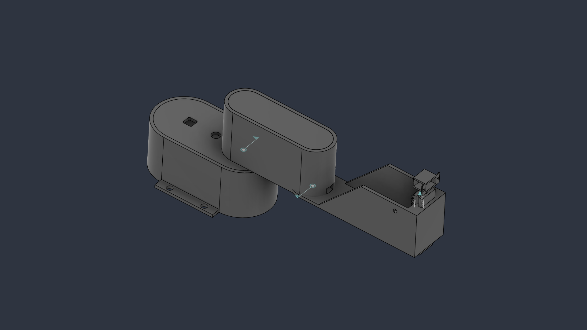

# Scara_Final — Robot Description



## Overview

| Property | Value |
|----------|-------|
| Total mass | 6.947 kg |
| Links | 4 |
| Joints | 3 (3 movable) |
| Assemblies | 3 |
| Root link | `base_link` |

## Table of Contents

- [Kinematic Tree](#kinematic-tree)
- [Link Properties](#link-properties)
- [Joint Properties](#joint-properties)
- [Assembly Breakdown](#assembly-breakdown)
- [Quick Start (ROS 2)](#quick-start-ros-2)
- [Files](#files)

## Kinematic Tree

```
base_link [BAKE]
  └─ Revoluci_n_2 [continuous]
    Link_1 [BAKE]
      └─ Revoluci_n_1 [continuous]
        Base_Link [BAKE]
  └─ Corredera_4 [prismatic]
    Cremallera2 [BAKE]
```

## Link Properties

| Link | Mass (kg) | Material | Collision | Bodies |
|------|-----------|----------|-----------|--------|
| `Base_Link` | 2.9235 | Acero | visual_reuse | 2 |
| `Cremallera2` | 0.3757 | Acero | visual_reuse | 1 |
| `Link_1` | 2.0360 | Acero | visual_reuse | 1 |
| `base_link` | 1.6116 | Acero | visual_reuse | 1 |

## Joint Properties

| Joint | Type | Parent → Child | Axis | Limits |
|-------|------|---------------|------|--------|
| `Corredera_4` | prismatic | `base_link` → `Cremallera2` | (1,0,0) | [15.0, 40.0] mm |
| `Revoluci_n_1` | continuous | `Link_1` → `Base_Link` | (0,0,1) | — |
| `Revoluci_n_2` | continuous | `base_link` → `Link_1` | (0,0,1) | — |

## Assembly Breakdown

### Base_Link

- **Links**: Base_Link
- **Total mass**: 2.924 kg

### Link_1

- **Links**: Link_1
- **Total mass**: 2.036 kg

### Scara_Final

- **Links**: base_link, Cremallera2
- **Total mass**: 1.987 kg

## Quick Start (ROS 2)

```bash
# 1. Copy package to your ROS 2 workspace
cp -r Scara_Final_description ~/ros2_ws/src/

# 2. Build
cd ~/ros2_ws
colcon build --packages-select Scara_Final_description
source install/setup.bash

# 3. Visualize in RViz2
ros2 launch Scara_Final_description display.launch.py

# 4. Validate URDF structure
check_urdf install/Scara_Final_description/share/Scara_Final_description/urdf/Scara_Final.urdf

# 5. Print kinematic tree
urdf_to_graphviz install/Scara_Final_description/share/Scara_Final_description/urdf/Scara_Final.urdf
```

**Joint control**: The launch file includes `joint_state_publisher_gui` —
use the sliders to move revolute/prismatic joints in RViz2.

**Topic inspection**:
```bash
# See published joint states
ros2 topic echo /joint_states

# See robot description parameter
ros2 param get /robot_state_publisher robot_description
```

## Files

| Path | Description |
|------|-------------|
| `urdf/Scara_Final.urdf.xacro` | Top-level xacro (entry point) |
| `urdf/Scara_Final.urdf` | Flat URDF (for validation) |
| `urdf/assemblies/` | Per-assembly xacro macros |
| `meshes/` | Visual (OBJ) and collision (STL) meshes |
| `launch/display.launch.py` | Launch robot_state_publisher, RViz, and generated controllers |
| `config/joint_state.yaml` | Joint state publisher config |
| `config/ros2_controllers.yaml` | Generated ros2_control controller manager config |
| `robot_data.yaml` | Supplementary data (beyond URDF) |
| `docs/transforms.md` | Transformation matrices (KaTeX) |

## Customizing

Assemblies tagged `!dummy_` are designed to be swapped out. To replace one:

1. Create your replacement as a xacro macro with the same interface
2. Place it in `urdf/assemblies/`
3. Update the `<xacro:include>` in `urdf/Scara_Final.urdf.xacro`
4. Update meshes in `meshes/<your_assembly>/`

The xacro prefix system (`${prefix}`) ensures link names stay unique
when multiple instances of the same assembly are used.

---
*Generated by Fusion URDF/XACRO Exporter v3.1.0*