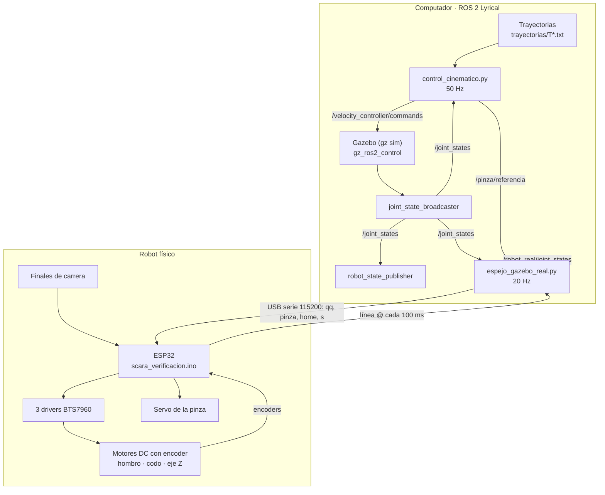

# Arquitectura del sistema

El sistema tiene tres capas: la **simulación** en ROS 2 y Gazebo, el **enlace** con el robot físico y el **control de bajo nivel** en el ESP32.



## 1. Software en el computador

| Componente | Archivo | Función |
|---|---|---|
| Modelo del robot | `Robrot_description/urdf/Robrot.urdf.xacro` | Geometría, juntas, límites y bloque `ros2_control`. Con `sim:=true` usa el hardware de Gazebo; con `sim:=false`, hardware simulado (mock) para RViz. |
| Simulación | `launch/gazebo.launch.py` | Abre Gazebo, publica el modelo, lo crea en la escena, enlaza `/clock` y carga los controladores. |
| Visualización | `launch/display.launch.py` | Abre RViz con el modelo y hardware simulado, sin física. |
| Controladores | `config/gz_controllers.yaml` (Gazebo) y `config/ros2_controllers.yaml` (RViz) | `joint_state_broadcaster` y `velocity_controller` (comandos de velocidad). |
| Control cinemático | `scripts/control_cinematico.py` | Recorre las trayectorias, limita la velocidad de cada junta, abre y cierra la pinza y guarda un registro CSV. |
| Gráficas | `scripts/graficar.py` | Grafica un registro: referencia contra posición real y velocidades con sus límites. |
| Enlace Gazebo → robot | `herramientas/espejo_gazebo_real.py` | Lee la pose de Gazebo y la envía al ESP32 como objetivo de posición. |
| Puente sin Gazebo | `scripts/puente_robot_real.py` | Alternativa: mueve el robot real sin simulación, integrando las velocidades del control y publicando los encoders en `/joint_states`. |

## 2. Tópicos

| Tópico | Tipo | Publica | Suscribe |
|---|---|---|---|
| `/velocity_controller/commands` | `std_msgs/Float64MultiArray` | `control_cinematico.py` | `velocity_controller` (Gazebo) o `puente_robot_real.py` |
| `/joint_states` | `sensor_msgs/JointState` | `joint_state_broadcaster` (Gazebo) | control, espejo, `robot_state_publisher` |
| `/pinza/referencia` | `std_msgs/Float64` | `control_cinematico.py` | espejo o puente |
| `/referencia` | `sensor_msgs/JointState` | `control_cinematico.py` | herramientas de graficación |
| `/robot_real/joint_states` | `sensor_msgs/JointState` | `espejo_gazebo_real.py` | RViz o registro |
| `/clock` | `rosgraph_msgs/Clock` | puente `ros_gz_bridge` | todos los nodos con `use_sim_time:=true` |

## 3. Juntas y orden de los comandos

`/velocity_controller/commands` lleva seis velocidades, **siempre en este orden**:

| # | Junta del URDF | Significado | Rango en el modelo |
|---|---|---|---|
| 1 | `Revoluci_n_6` | q1, hombro | −73.9° a 46.1° (límite real del firmware) |
| 2 | `Revoluci_n_7` | q2, codo | −45.5° a 134.5° (límite real del firmware) |
| 3 | `Corredera_9` | d3, eje Z; positivo = baja | 0 (arriba) a 0.085 m (abajo, home) |
| 4 | `Revoluci_n_12` | servo de la pinza | 0 cerrada, π/2 abierta |
| 5 | `Corredera_13` | dedo 1 | 0 a 0.018 m |
| 6 | `Corredera_14` | dedo 2 | 0 a 0.018 m |

## 4. Hardware

| Elemento | Detalle |
|---|---|
| Microcontrolador | ESP32 DevKit V1 (DOIT), USB serie a 115200 baudios |
| Drivers | 3 × BTS7960 (puente H), PWM de 20 kHz y 10 bits |
| Motores | DC con encoder en cuadratura: hombro 13.15 cuentas/°, codo 22.20 cuentas/°, eje Z 25.50 cuentas/mm |
| Transmisión del eje Z | Piñón-cremallera |
| Finales de carrera | Uno por eje, en GPIO 21 (hombro), 22 (codo) y 15 (Z) |
| Pinza | Servo en GPIO 13: 25° cerrada, 145° abierta |
| Alimentación | 24 V para los motores |

Los pines de cada motor, encoder y driver están al inicio de `scara_verificacion.ino`.

## 5. Protocolo serie con el ESP32

Comandos que usa el sistema (texto terminado en salto de línea):

| Comando | Qué hace |
|---|---|
| `rep 1` | Activa el envío del estado cada 100 ms |
| `reset` | Sale del estado de falla |
| `home` | Busca los finales de carrera en orden: Z, codo y hombro |
| `qq <hombro°> <codo°> <z mm>` | Objetivo de posición en coordenadas del firmware. Se ignora hasta completar el home. |
| `pinza <grados>` | Mueve el servo (25 a 145) |
| `s` | Detiene todos los ejes |

El ESP32 responde con una línea de estado:

```text
@,estado,hombro_deg,codo_deg,z_mm,t1,t2,tz,x_mm,y_mm,homed,fc
```

`homed` tiene un dígito por eje (`111` = los tres con home). El firmware tiene más comandos para calibración y pruebas (`jog`, `k`, `set`, `xyz`, `cuadrado`); están en su [guía de verificación](../../codigo_fuente/microcontrolador/scara_verificacion/GUIA_VERIFICACION.md).

**No uses los comandos `gz` y `gzxyz` del firmware** con el modelo actual: usan una convención anterior del modelo.
