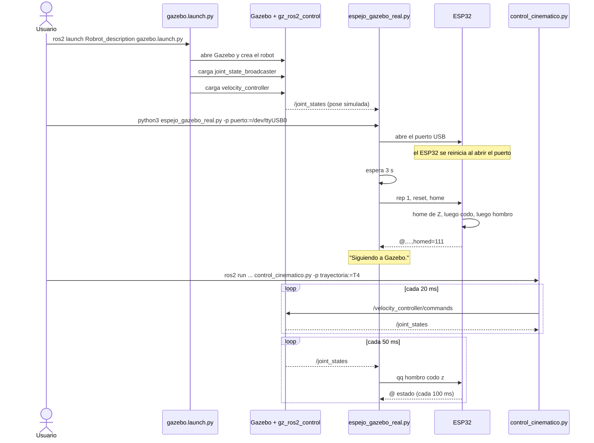
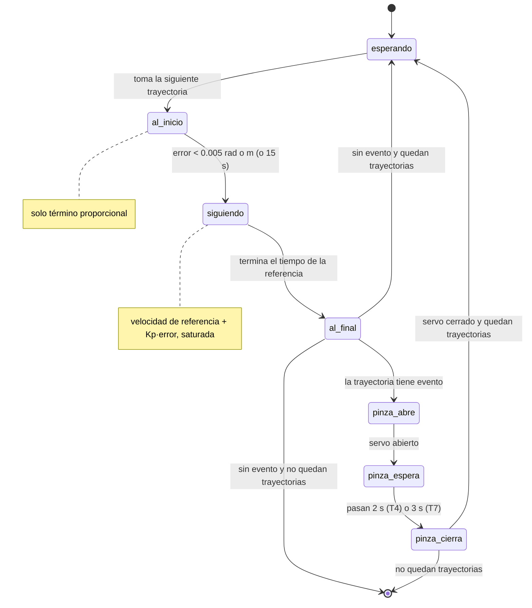
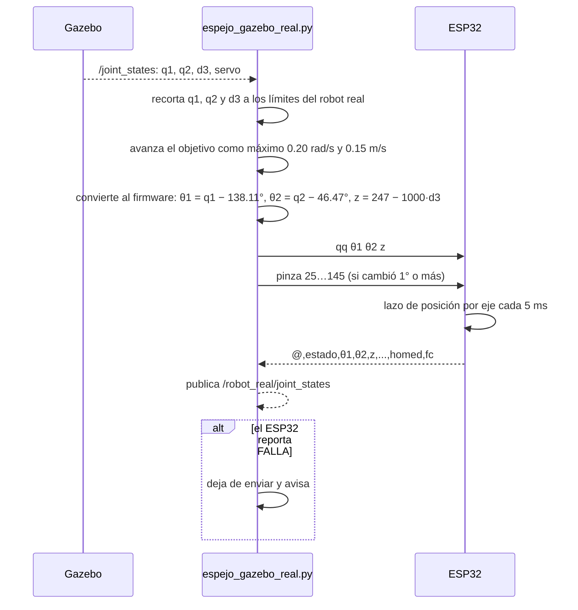

# Diagramas de secuencia

## 1. Arranque del sistema completo (Gazebo + robot físico)

## 2. Ciclo de una trayectoria con evento de pinza

Así recorre `control_cinematico.py` cada trayectoria. Los eventos de la pinza se definen con el parámetro `pinza_eventos` (por defecto `"T4:2,T7:3"`).

| Al terminar | Acción de la pinza | Tiempo abierta |
|---|---|---|
| T4 | abre, espera y cierra | 2 s |
| T7 | abre, espera y cierra | 3 s |
| T1, T8, T19 | permanece cerrada | — |

## 3. Enlace Gazebo → robot físico, cada 50 ms

## 4. Detener el robot

| Situación | Qué pasa |
|---|---|
| `Ctrl + C` en el control | Envía velocidad cero a todas las juntas |
| `Ctrl + C` en el espejo | Envía `s` al ESP32 y cierra el puerto |
| Botón BOOT del ESP32 | Detiene todos los ejes de inmediato |
| Eje trabado | El firmware sube el PWM de a poco; si aun así no se mueve, entra en FALLA y para |
