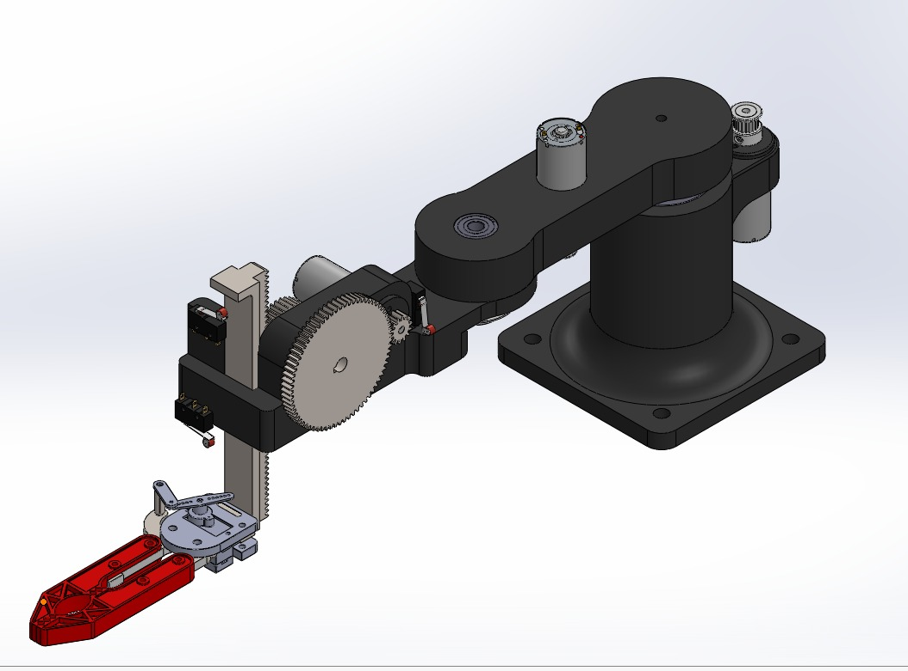
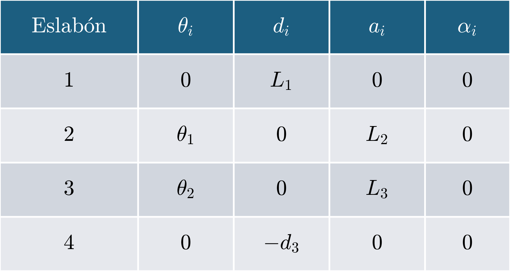
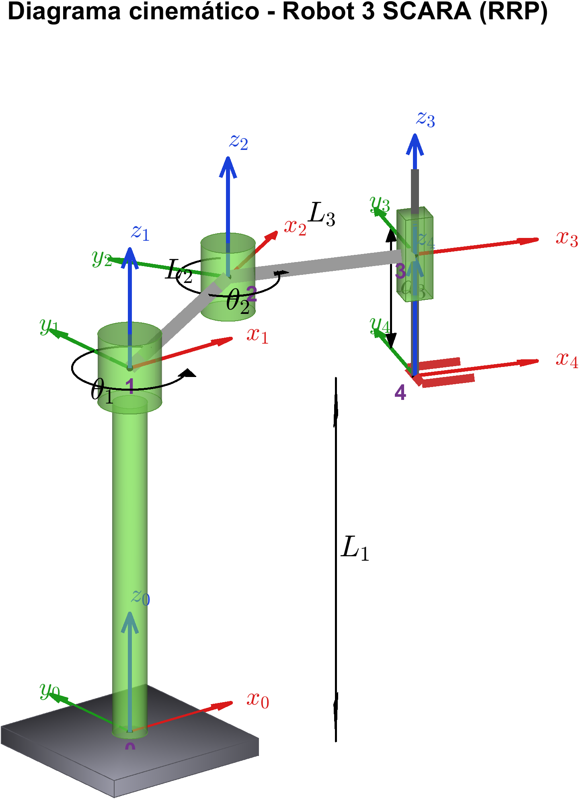
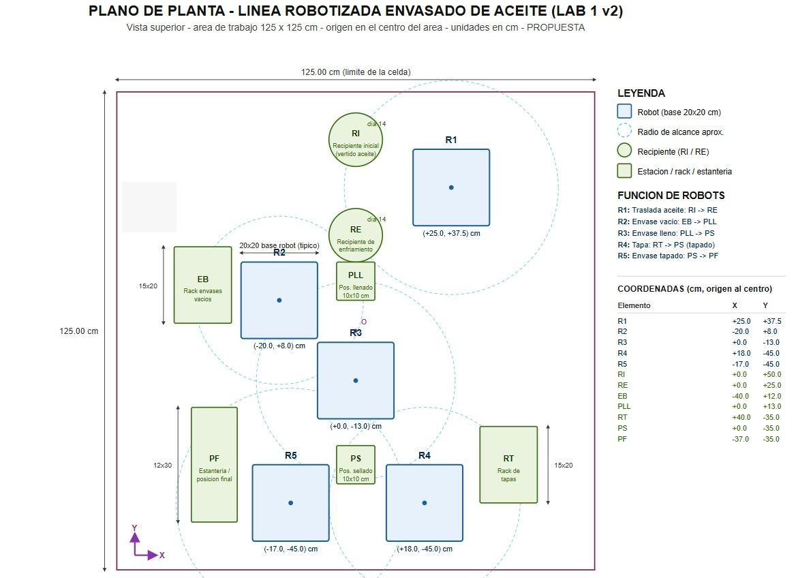
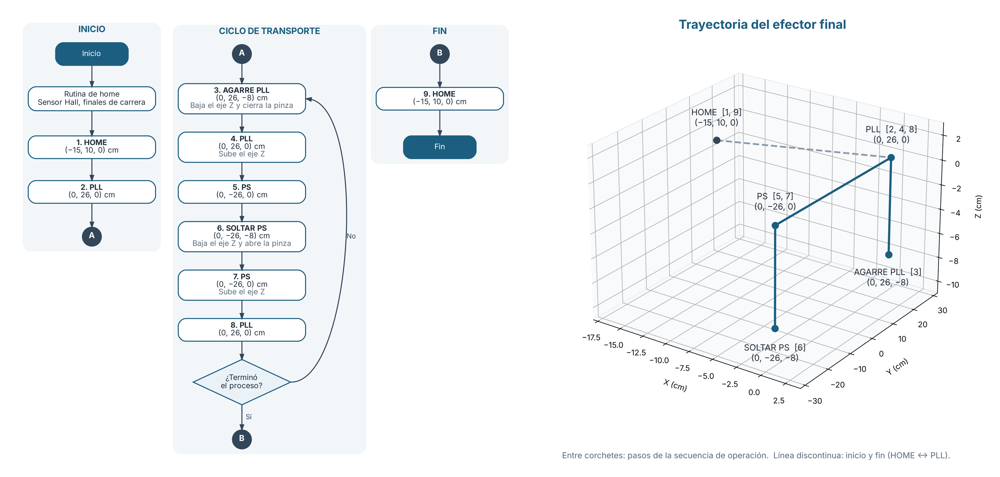
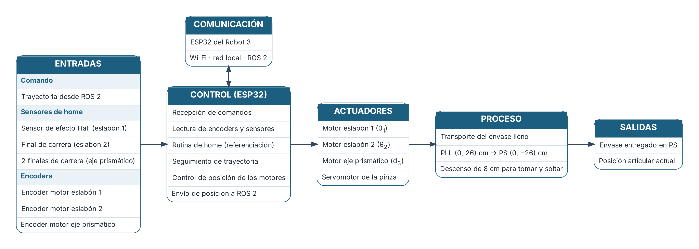
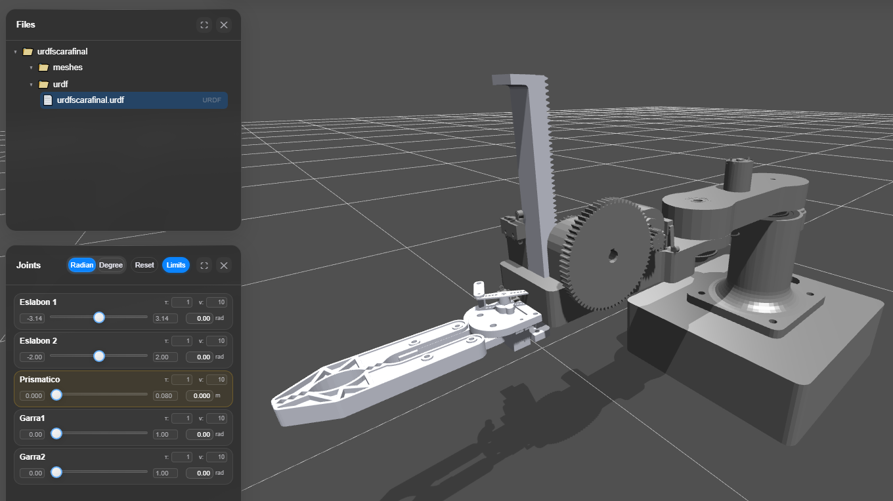
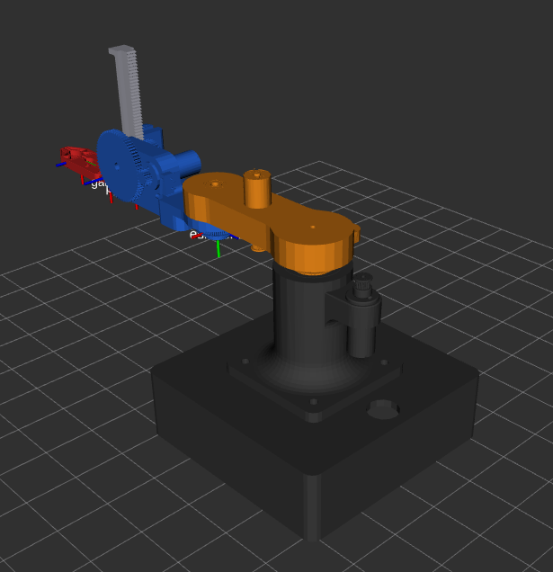
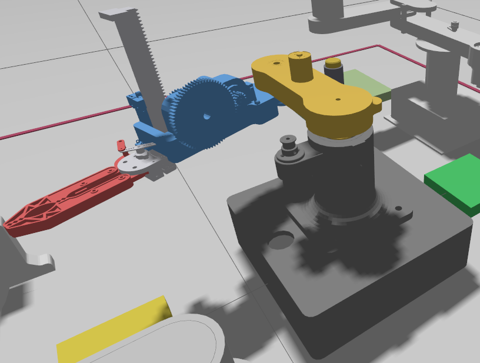

# Robot 3: Transporte de Envases a Sellado

**Integrantes:** Fabio Alejandro Guerrero Cifuentes - Juan Sebastián Sánchez - Jordy Alberto Mendoza - Julián Santiago Peña

**Manipulador SCARA de dos eslabones encargado de trasladar envases llenos y abiertos desde la estación de llenado hasta la estación de sellado, dentro de una línea robotizada de envasado de aceite coordinada mediante ROS 2.**

<p align="center">
  
</p>

---

## Descripción

El Robot 3 es el tercer eslabón de una línea de cinco manipuladores que automatiza el envasado de aceite. Su tarea es la más sensible al derrame dentro de la línea, porque manipula el envase **lleno y sin tapa**. Por eso el diseño prioriza mantener el envase en posición vertical, limitar las aceleraciones durante el transporte y sincronizarse con los robots adyacentes.

El proyecto abarca el análisis del contexto de la línea, la arquitectura del sistema y la distribución de la planta. Incluye además el diseño mecánico y eléctrico del robot en SolidWorks, su modelado cinemático directo e inverso con validación, los lazos de control de bajo nivel y la planeación de trayectorias en el espacio articular. El robot se visualizó en RViz, se simuló en Gazebo y se implementó en físico con un ESP32 que se comunica por Wi-Fi con una interfaz de escritorio y con el coordinador de la celda.

### Robot

| Parámetro | Valor |
|-----------|-------|
| Arquitectura | SCARA (RRP) |
| Grados de libertad | 3 |
| Eslabones | 2 |
| Articulaciones | Hombro (rotacional), codo (rotacional), eje Z (prismática) |
| Actuadores | 2 motores para el giro de los eslabones, 1 motor para el eje prismático, 1 servomotor para la pinza |
| Sensores | 3 encoders (uno por motor), sensor de efecto Hall (eslabón 1), final de carrera (eslabón 2), 2 finales de carrera (eje prismático) |
| Efector final | Pinza |
| Altura de la base | 170.4 mm |
| Longitud eslabón 1 (L₁) | 130 mm |
| Longitud eslabón 2 (L₂) | 150 mm |
| Pinza (G), colineal con el eslabón 2 | 110 mm |
| Distancia codo → centro de la pinza (L₂ + G) | 260 mm |
| Carrera eje Z | 80 mm |
| Alcance máximo (centro de la pinza) | 390 mm |
| Rango del codo (θ₂) | ±2 rad |
| Controlador | ESP32 con comunicación Wi-Fi (UDP) |
| Velocidad máxima | 60 °/s ≈ 1.05 rad/s (rotacionales), 30 mm/s (prismática) |

### Tarea

| Parámetro | Valor |
|-----------|-------|
| Función | Transporte del envase lleno: llenado (PLL) → sellado (PS) |
| Posición de la base en la celda | (0.0, -13.0) cm respecto al centro de la celda |
| HOME | (0, 22.5, 0) cm respecto a la base del robot |
| HOME 2 | (13, 26, 0) cm respecto a la base del robot |
| Estación de origen (PLL) | (0, 26, 0) cm respecto a la base del robot |
| Estación de destino (PS) | (0, -26, 0) cm respecto a la base del robot |
| Descenso para tomar y soltar | 8 cm |
| Robot que entrega | R2 (alimentación de envases) |
| Robot que recibe | R4 (tapado) |

<p align="center">
  
</p>


### Video Robot IRL
https://github.com/user-attachments/assets/bb6255e8-6ec9-482f-a3ae-68ecb273bba6


---

## Estructura del repositorio

- [Descripción](#descripción)
- [Tecnologías](#tecnologías)
- [Modelado cinemático](#modelado-cinemático)
- [Ubicación en la línea](#ubicación-en-la-línea)
- [Planeación de trayectorias](#planeación-de-trayectorias)
  - [Cinemática directa](#cinemática-directa)
  - [Cinemática inversa](#cinemática-inversa)
  - [Trayectorias en el espacio articular](#trayectorias-en-el-espacio-articular)
- [Secuencia de operación](#secuencia-de-operación)
- [Arquitectura](#arquitectura)
- [Diseño mecánico y eléctrico](#diseño-mecánico-y-eléctrico)
- [Control](#control)
- [Firmware e interfaz](#firmware-e-interfaz)
- [Modelo URDF](#modelo-urdf)
- [RViz](#rviz)
- [Gazebo](#gazebo)
- [Comunicación](#comunicación)
- [Cartilla](#cartilla)

---

## Tecnologías

| Área | Herramientas |
|------|--------------|
| Diseño mecánico (CAD) |  |
| Robótica y simulación |    |
| Análisis y cálculo |  |
| Sistemas embebidos |  |
| Programación |   |
| Entorno de desarrollo |    |

---

## Modelado cinemático

El robot se modeló como una cadena cinemática serial RRP mediante la convención de Denavit-Hartenberg. Las dos primeras articulaciones son rotacionales con ejes verticales paralelos y ubican el efector final en el plano XY. La tercera es prismática y controla de forma independiente la altura del efector en el eje Z. Gracias a esta configuración, la pinza mantiene siempre la orientación vertical, lo que permite transportar el envase abierto sin inclinarlo.

La pinza está alineada con el eslabón 2 y sobresale 110 mm más allá del eje Z. Por eso la cinemática se calcula hasta el **centro de la pinza**, que es donde se sujeta el envase, con una longitud efectiva de L₂ + G = 260 mm.

<p align="center">
  
  
</p>

---

## Ubicación en la línea

El Robot 3 ocupa la posición central de la celda (1.25 m x 1.25 m), entre la estación de llenado y la de sellado, ambas alineadas sobre el eje Y. Comparte dos zonas de trabajo con otros robots:

- **Estación de llenado (PLL):** zona compartida con el Robot 2, que deposita allí el envase.
- **Estación de sellado (PS):** zona compartida con el Robot 4, que coloca la tapa.

<p align="center">
  
</p>

---

## Planeación de trayectorias

Las trayectorias se planean en el espacio articular con perfiles suaves que limitan la aceleración, para evitar oscilaciones del aceite en el envase abierto.

### Cinemática directa

La cinemática directa obtiene la posición del centro de la pinza a partir de los valores articulares θ₁, θ₂ y d. Los ángulos se miden desde la posición HOME del robot, por lo que se suman los desfases de montaje de cada articulación (90° en el hombro y −120° en el codo):

```
α₁ = θ₁ + 90°
α₂ = α₁ + θ₂ − 120°

X = L₁·cos(α₁) + (L₂ + G)·cos(α₂)
Y = L₁·sin(α₁) + (L₂ + G)·sin(α₂)
z = d
```

con L₁ = 13 cm, L₂ = 15 cm y G = 11 cm. La posición en el plano depende de los dos ángulos, mientras que la altura depende únicamente del desplazamiento del eje prismático. El alcance máximo del centro de la pinza es de 390 mm, y las estaciones PLL y PS están a 260 mm de la base, dentro del espacio de trabajo. El eje Z tiene 80 mm de recorrido.

Código: [cinematica_directa.m](docs/C_directa/cinematica_directa.m)

### Cinemática inversa

La cinemática inversa calcula los valores articulares necesarios para llevar el centro de la pinza a una posición deseada. En el plano XY, los ángulos del hombro y del codo se obtienen de forma geométrica con la longitud efectiva L₂ + G, considerando las dos configuraciones posibles del codo; se elige la que deja θ₂ dentro de ±2 rad con mayor holgura. El desplazamiento del eje Z se obtiene directamente de la altura requerida. Cada solución se valida evaluándola en la cinemática directa.

| Punto | Posición (cm) | θ₁ | θ₂ | d (cm) |
|-------|---------------|----|----|--------|
| HOME | (0, 22.5, 0) | 0° | 0° | 0 |
| HOME 2 | (13, 26, 0) | 0° | 30° | 0 |
| PLL | (0, 26, 0) | −14.5° | 15.5° | 0 |
| AGARRE PLL | (0, 26, −8) | −14.5° | 15.5° | −8 |
| PS | (0, −26, 0) | 165.5° | 15.5° | 0 |
| SOLTAR PS | (0, −26, −8) | 165.5° | 15.5° | −8 |

PS se alcanza con el mismo ángulo de codo que PLL y el hombro girado 180°, porque ambas estaciones están a la misma distancia de la base y en lados opuestos.

Documento: [Cinemática inversa y validación (PDF)](docs/cinematica_inversa.pdf) · Código: [C_inversa](docs/C_inversa/)

### Trayectorias en el espacio articular

Las trayectorias se generan en el espacio de articulaciones entre los puntos clave de la tarea: HOME, estación de llenado y estación de sellado. Cada articulación sigue un perfil de movimiento continuo que respeta los límites de velocidad del sistema y evita arranques y frenados bruscos durante el transporte del envase lleno.

En el robot real, el ESP32 genera un perfil trapezoidal coordinado: calcula el tiempo que necesita cada articulación para llegar a su destino sin pasar su velocidad máxima y usa el mayor, de modo que las tres articulaciones arrancan y terminan juntas. El 25 % del tiempo se dedica a acelerar y otro 25 % a frenar.

---

## Secuencia de operación

<p align="center">
  
</p>

---

## Arquitectura

<p align="center">
  
</p>

| Bloque | Elementos |
|--------|-----------|
| Entradas | Órdenes desde la interfaz o el coordinador de la celda, sensor de efecto Hall (eslabón 1), final de carrera (eslabón 2), 2 finales de carrera (eje prismático), encoders de los tres motores |
| Procesamiento (ESP32) | Recepción de comandos, lectura de encoders y sensores, rutina de home, generación de trayectoria, control de posición de los motores, envío de posición |
| Actuadores | Motor del eslabón 1, motor del eslabón 2, motor del eje prismático, servomotor de la pinza |
| Salidas | Envase entregado en PS, posición articular actual |

---

## Diseño mecánico y eléctrico

Los planos mecánicos y eléctricos se elaboraron siguiendo las normas ISO 5457 y IEC 60617.

### Diseño mecánico

La estructura está compuesta por una base fija con columna, dos eslabones horizontales accionados en el hombro y el codo, y un eje vertical con mecanismo de piñón y cremallera que desplaza la pinza. El recorrido del eje Z se delimita con finales de carrera. La pinza, accionada por un servomotor, se diseñó para la geometría del envase, de modo que lo sujete sin deformarlo y sin permitir desplazamientos laterales.

Documento: [Planos mecánicos (PDF)](docs/planos_mecanicos.pdf)

### Diseño eléctrico

El sistema eléctrico se centraliza en un ESP32, que controla los tres motores de las articulaciones y el servomotor de la pinza. Lee los encoders de cada motor y los sensores de home: un sensor de efecto Hall en el eslabón 1, un final de carrera en el eslabón 2 y dos finales de carrera en el eje prismático. Los planos incluyen las conexiones de potencia y de control, la alimentación del sistema y el cableado de sensores y actuadores.

Documento: [Planos eléctricos (PDF)](docs/planos_electricos.pdf)

---

## Control

Cada articulación tiene un lazo de control de posición que se ejecuta en el ESP32 cada 10 ms (100 Hz):

1. Los encoders de cuadratura se leen por interrupciones y se convierten en posición (cm para el eje Z, grados para el hombro y el codo).
2. La trayectoria trapezoidal entrega la referencia de cada articulación en ese instante.
3. Un controlador PID discreto, implementado como ecuación en diferencias, calcula el voltaje a partir del error.
4. El voltaje se limita a ±12 V y se aplica al motor por PWM a través del puente H.

Al encender, el robot se calibra solo: mueve el codo hasta su final de carrera y toma ese punto como cero. Los finales de carrera también detienen el motor si una articulación llega a su límite.

---

## Firmware e interfaz

El robot real tiene dos modos de operación, cada uno con su propio firmware para el ESP32. Los dos usan la misma lógica de control, los mismos puntos de la tarea y la misma máquina de estados.

| Modo | Firmware | Programa en el PC | Para qué sirve |
|------|----------|-------------------|----------------|
| Celda completa | [Esp32_Gazebo.ino](firmware/Esp32_Gazebo/Esp32_Gazebo.ino) | Coordinador de la celda en ROS 2 ([General](../General/Gazebo/celda_aceite/)) | El robot real recibe las órdenes de la celda simulada en Gazebo y se mueve sincronizado con los demás robots |
| Control manual | [Esp32_interfaz.ino](firmware/Esp32_interfaz/Esp32_interfaz.ino) | [interfaz.py](firmware/Esp32_interfaz/interfaz.py) | Operar, probar y calibrar el robot desde una interfaz de escritorio |

### Máquina de estados

El firmware solo acepta las órdenes que tienen sentido en el estado actual, para evitar movimientos peligrosos con el envase abierto:

| Orden | Se permite cuando |
|-------|-------------------|
| PLL, PS | El robot está calibrado |
| AGARRE PLL | El robot está en PLL arriba |
| SOLTAR PS | El robot está en PS arriba |
| HOME, HOME2, CAL, STOP | Siempre |

Cada orden se ejecuta como una secuencia de pasos: primero sube el eje Z a la altura segura, luego mueve el hombro y el codo, y al final baja y abre o cierra la pinza. Si un motor no llega a tiempo, la secuencia se cancela.

### Interfaz de escritorio

<p align="center">
  

</p>

La interfaz está hecha en Python con Tkinter y Matplotlib, y se comunica con el ESP32 por UDP. Permite:

- Ejecutar el ciclo con botones: PLL, AGARRE PLL, PS, SOLTAR PS, HOME, HOME2, CAL.
- Mover cada motor por separado, controlar la pinza y ajustar la velocidad.
- Ver en tiempo real el estado de los sensores (Hall y finales de carrera).
- Dibujar la trayectoria del centro de la pinza en el plano a partir de la posición que reporta el robot.
- Detener todo con el botón STOP o la tecla Esc.

En la interfaz, escribe la IP que muestra el ESP32 por el monitor serie y pulsa **Probar (ESTADO)**.

### Comandos

Los dos firmwares aceptan estos comandos por el monitor serie o por UDP (puerto 4210):

| Comando | Acción |
|---------|--------|
| `PLL`, `AGARRE PLL`, `PS`, `SOLTAR PS` | Pasos del ciclo |
| `HOME`, `HOME2` | Ir a la posición de reposo |
| `CAL` | Calibrar el codo contra su final de carrera |
| `STOP` | Detener todos los motores |
| `M1 8`, `M2 120`, `M3 90` | Mover un motor (cm o grados) |
| `S 90` | Mover la pinza (grados del servo) |
| `V 70` | Velocidad en % de la máxima |
| `ESTADO`, `IP`, `P` | Estado, dirección IP y pulsos de los encoders |

> Antes de cargar el firmware, escribe el nombre y la contraseña de tu red en `WIFI_SSID` y `WIFI_PASS`.

---

## Modelo URDF

El modelo URDF describe el robot para ROS 2 a partir del diseño CAD. Define los eslabones con su geometría visual, de colisión y sus propiedades inerciales, y las articulaciones del robot: dos rotacionales para el hombro y el codo, y una prismática para el eje Z, cada una con sus límites de movimiento y velocidad.

<p align="center">
  
</p>

Carpeta: [URDF](ros2_ws/URDF/)

---

## RViz

En RViz se visualiza el modelo URDF del robot para verificar la estructura de eslabones, los marcos de referencia y el rango de movimiento de cada articulación. También se usó para comprobar visualmente los resultados de la cinemática directa e inversa antes de pasar a la simulación física.

<p align="center">
  
</p>

Carpeta: [RVIZ](ros2_ws/RVIZ/)

---

## Gazebo

En Gazebo se simula el comportamiento físico del robot, con gravedad, inercias y colisiones. Sobre esta simulación se ejecutan las trayectorias planeadas en el espacio articular, para validar que el robot lleva el envase de la estación de llenado (PLL) a la de sellado (PS) sin superar los límites de velocidad y manteniendo la pinza vertical.

### Robot 3 individual

<p align="center">
  
</p>

Carpeta: [GAZEBO](ros2_ws/GAZEBO/)

### Integración en la celda completa

El Robot 3 también se simuló dentro de la celda completa de envasado, junto a los otros cuatro manipuladores. Un nodo maestro en ROS 2 coordina la secuencia y decide qué robot entra a cada zona compartida. En el video se ve a R3 recibir el envase lleno de R2 en PLL y llevarlo a PS, donde R4 lo tapa.

Con el firmware [Esp32_Gazebo.ino](firmware/Esp32_Gazebo/Esp32_Gazebo.ino), el robot real se conecta a esta misma celda: se anuncia al coordinador, recibe las órdenes de cada tramo (ir a PLL y agarrar, llevar a PS y soltar, volver a HOME) y responde cuando termina, de modo que la simulación y el robot físico avanzan juntos.


https://github.com/user-attachments/assets/b5541e5b-ad29-474a-bef0-c1ec990cce00


---

## Comunicación

| Elemento | Medio de conexión | Función |
|----------|-------------------|---------|
| ESP32 del Robot 3 | Wi-Fi (UDP) | Recibe órdenes, controla los actuadores y reporta la posición articular |
| Interfaz de escritorio | Wi-Fi (UDP, puerto 4210) | Envía comandos al ESP32 y muestra su estado y posición |
| Coordinador de la celda (ROS 2) | Wi-Fi (UDP, puerto 5005 en el PC y 6003 en el ESP32) | Envía al Robot 3 las órdenes de cada tramo y recibe el aviso de que terminó |
| Router central | Red local | Enlaza los controladores de los robots con los equipos de ROS 2 |

---

## Cartilla

[Cartilla_Scara_Jr_Grupo3.pdf](https://github.com/user-attachments/files/35244707/Cartilla_Scara_Jr_Grupo3.pdf)
