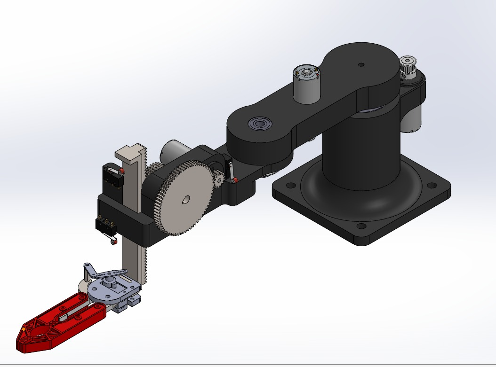
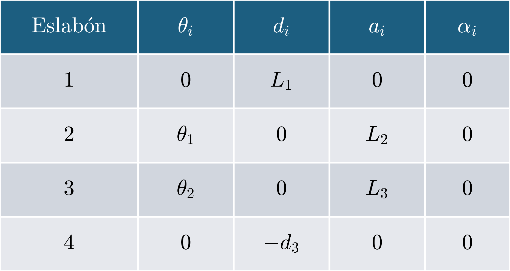
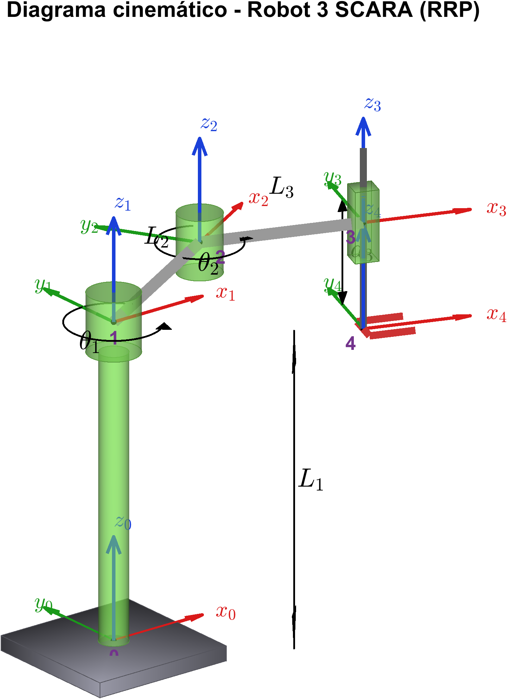
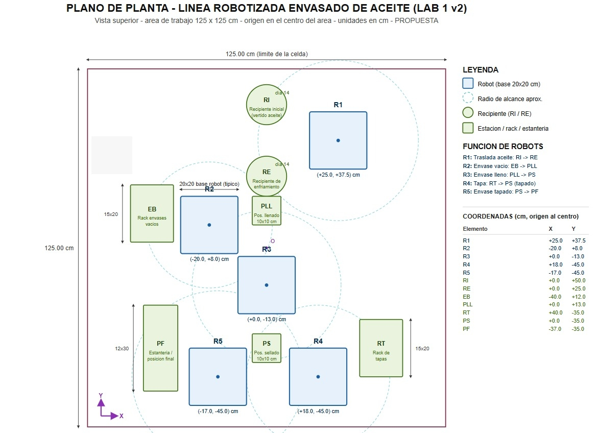
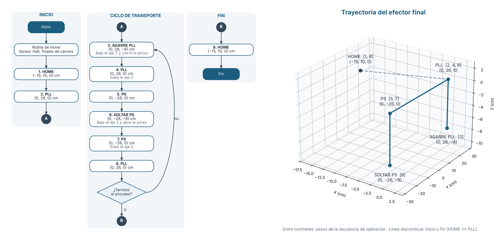
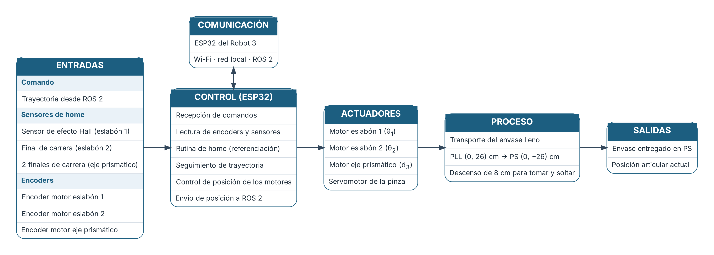
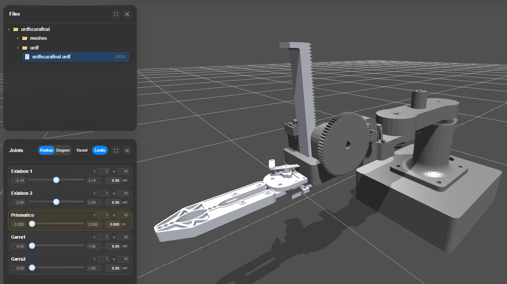
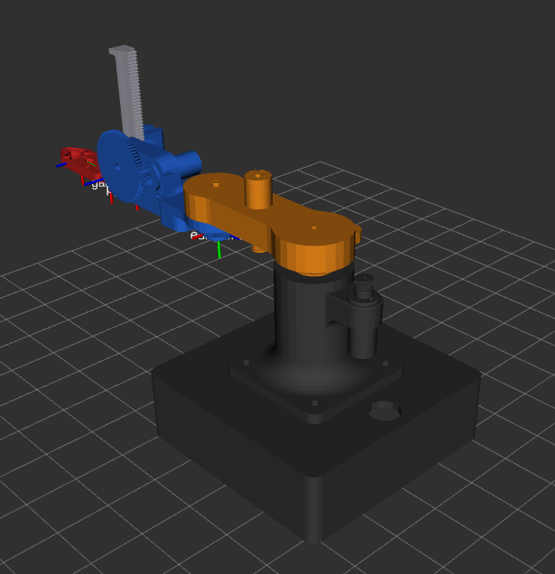
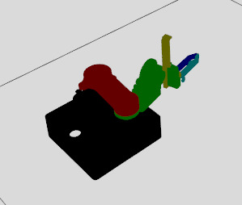

# Robot 3: Transporte de Envases a Sellado

**Integrantes:** Fabio Alejandro Guerrero Cifuentes - Juan Sebastián Sánchez - Jordy Alberto Mendoza - Julián Santiago Peña

**Manipulador SCARA de dos eslabones encargado de trasladar envases llenos y abiertos desde la estación de llenado hasta la estación de sellado, dentro de una línea robotizada de envasado de aceite coordinada mediante ROS 2.**

<p align="center">
  
</p>

---

## Descripción

El Robot 3 es el tercer eslabón de una línea de cinco manipuladores que automatiza el envasado de aceite. Su tarea es la más sensible al derrame dentro de la línea, porque manipula el envase **lleno y sin tapa**. Por eso el diseño prioriza mantener el envase en posición vertical, limitar las aceleraciones durante el transporte y sincronizarse con los robots adyacentes.

El proyecto abarca el análisis del contexto de la línea, la arquitectura del sistema y la distribución de la planta. Incluye además el diseño mecánico y eléctrico del robot en SolidWorks, su modelado cinemático directo e inverso con validación, los lazos de control de bajo nivel y la planeación de trayectorias en el espacio articular. El robot se visualizó en RViz y se simuló en Gazebo, integrado a la comunicación ROS 2 - ESP32 de la línea.

### Robot

| Parámetro | Valor |
|-----------|-------|
| Arquitectura | SCARA (RRP) |
| Grados de libertad | 3 |
| Eslabones | 2 |
| Articulaciones | Hombro (rotacional), codo (rotacional), eje Z (prismática) |
| Actuadores | 2 motores para el giro de los eslabones, 1 motor para el eje prismático, 1 servomotor para la pinza |
| Sensores | 3 encoders (uno por motor), sensor de efecto Hall (eslabón 1), final de carrera (eslabón 2), 2 finales de carrera (eje prismático) |
| Efector final | Pinza |
| Altura de la base | 170.4 mm |
| Longitud eslabón 1 | 130.0 mm |
| Longitud eslabón 2 | 147.6 mm |
| Carrera eje Z | 80 mm |
| Alcance máximo | 277.6 mm |
| Controlador | ESP32 con comunicación Wi-Fi |
| Límites de velocidad | 2 rad/s (rotacionales), 0.15 m/s (prismática) |

### Tarea

| Parámetro | Valor |
|-----------|-------|
| Función | Transporte del envase lleno: llenado (PLL) → sellado (PS) |
| Posición de la base en la celda | (0.0, -13.0) cm respecto al centro de la celda |
| HOME | (-15, 10, 0) cm respecto a la base del robot |
| Estación de origen (PLL) | (0, 26, 0) cm respecto a la base del robot |
| Estación de destino (PS) | (0, -26, 0) cm respecto a la base del robot |
| Descenso para tomar y soltar | 8 cm |
| Robot que entrega | R2 (alimentación de envases) |
| Robot que recibe | R4 (tapado) |

<p align="center">
  
</p>

---

## Estructura del repositorio

- [Descripción](#descripción)
- [Tecnologías](#tecnologías)
- [Modelado cinemático](#modelado-cinemático)
- [Ubicación en la línea](#ubicación-en-la-línea)
- [Planeación de trayectorias](#planeación-de-trayectorias)
  - [Cinemática directa](#cinemática-directa)
  - [Cinemática inversa](#cinemática-inversa)
  - [Trayectorias en el espacio articular](#trayectorias-en-el-espacio-articular)
- [Secuencia de operación](#secuencia-de-operación)
- [Arquitectura](#arquitectura)
- [Diseño mecánico y eléctrico](#diseño-mecánico-y-eléctrico)
- [Control](#control)
- [Modelo URDF](#modelo-urdf)
- [RViz](#rviz)
- [Gazebo](#gazebo)
- [Comunicación](#comunicación)
- [Cartilla](#cartilla)

---

## Tecnologías

| Área | Herramientas |
|------|--------------|
| Diseño mecánico (CAD) |  |
| Robótica y simulación |    |
| Análisis y cálculo |  |
| Sistemas embebidos |  |
| Programación |   |
| Entorno de desarrollo |    |

---

## Modelado cinemático

El robot se modeló como una cadena cinemática serial RRP mediante la convención de Denavit-Hartenberg. Las dos primeras articulaciones son rotacionales con ejes verticales paralelos y ubican el efector final en el plano XY. La tercera es prismática y controla de forma independiente la altura del efector en el eje Z. Gracias a esta configuración, la pinza mantiene siempre la orientación vertical, lo que permite transportar el envase abierto sin inclinarlo.

<p align="center">
  
  
</p>

---

## Ubicación en la línea

El Robot 3 ocupa la posición central de la celda (1.25 m x 1.25 m), entre la estación de llenado y la de sellado, ambas alineadas sobre el eje Y. Comparte dos zonas de trabajo con otros robots:

- **Estación de llenado (PLL):** zona compartida con el Robot 2, que deposita allí el envase.
- **Estación de sellado (PS):** zona compartida con el Robot 4, que coloca la tapa.

<p align="center">
  
</p>

---

## Planeación de trayectorias

Las trayectorias se planean en el espacio articular con perfiles suaves que limitan la aceleración, para evitar oscilaciones del aceite en el envase abierto.

### Cinemática directa

La cinemática directa obtiene la posición del efector final a partir de los valores articulares θ₁, θ₂ y d₃, mediante el producto de las matrices de transformación homogénea de cada eslabón:

```
x = L₂·cos(θ₁) + L₃·cos(θ₁ + θ₂)
y = L₂·sin(θ₁) + L₃·sin(θ₁ + θ₂)
z = L₁ − d₃
```

La posición en el plano depende de los dos ángulos y de la longitud de los eslabones, mientras que la altura depende únicamente del desplazamiento del eje prismático. El espacio de trabajo es un anillo de 150.7 mm a 277.6 mm de radio, limitado por el rango del codo, con 80 mm de recorrido vertical.

Código: [cinematica_directa.m](docs/C_directa/cinematica_directa.m)

### Cinemática inversa

La cinemática inversa calcula los valores articulares necesarios para llevar la pinza a una posición deseada. En el plano XY, los ángulos del hombro y del codo se obtienen de forma geométrica a partir de la posición objetivo, considerando las dos configuraciones posibles del codo. El desplazamiento del eje Z se obtiene directamente de la altura requerida. La solución se validó comparando sus resultados con la cinemática directa en las posiciones de trabajo del robot.

Documento: [Cinemática inversa y validación (PDF)](docs/cinematica_inversa.pdf) · Código: [C_indirecta](docs/C_indirecta/)

### Trayectorias en el espacio articular

Las trayectorias se generan en el espacio de articulaciones entre los puntos clave de la tarea: HOME, estación de llenado y estación de sellado. Cada articulación sigue un perfil de movimiento continuo que respeta los límites de velocidad del sistema y evita arranques y frenados bruscos durante el transporte del envase lleno.

Documento: [Planeación de trayectorias (PDF)](docs/planeacion_trayectorias.pdf)

---

## Secuencia de operación

<p align="center">
  
</p>

---

## Arquitectura

<p align="center">
  
</p>

| Bloque | Elementos |
|--------|-----------|
| Entradas | Trayectoria desde ROS 2, sensor de efecto Hall (eslabón 1), final de carrera (eslabón 2), 2 finales de carrera (eje prismático), encoders de los tres motores |
| Procesamiento (ESP32) | Recepción de comandos, lectura de encoders y sensores, rutina de home, seguimiento de trayectoria, control de posición de los motores, envío de posición a ROS 2 |
| Actuadores | Motor del eslabón 1, motor del eslabón 2, motor del eje prismático, servomotor de la pinza |
| Salidas | Envase entregado en PS, posición articular actual |

---

## Diseño mecánico y eléctrico

Los planos mecánicos y eléctricos se elaboraron siguiendo las normas [nombre de las normas aplicadas].

### Diseño mecánico

La estructura está compuesta por una base fija con columna, dos eslabones horizontales accionados en el hombro y el codo, y un eje vertical con mecanismo de piñón y cremallera que desplaza la pinza. El recorrido del eje Z se delimita con finales de carrera. La pinza, accionada por un servomotor, se diseñó para la geometría del envase, de modo que lo sujete sin deformarlo y sin permitir desplazamientos laterales.

Documento: [Planos mecánicos (PDF)](docs/planos_mecanicos.pdf)

### Diseño eléctrico

El sistema eléctrico se centraliza en un ESP32, que controla los tres motores de las articulaciones y el servomotor de la pinza. Lee los encoders de cada motor y los sensores de home: un sensor de efecto Hall en el eslabón 1, un final de carrera en el eslabón 2 y dos finales de carrera en el eje prismático. Los planos incluyen las conexiones de potencia y de control, la alimentación del sistema y el cableado de sensores y actuadores.

Documento: [Planos eléctricos (PDF)](docs/planos_electricos.pdf)

---

## Control

Cada articulación cuenta con un lazo de control de bajo nivel, ejecutado en el ESP32, que usa la realimentación de su encoder para llevar el actuador a la posición indicada por la trayectoria. El informe presenta el modelado de los actuadores, el diseño y la sintonización de los controladores, y el análisis de la respuesta obtenida en cada articulación.

Documento: [Informe de control (PDF)](docs/informe_control.pdf)

---

## Modelo URDF

El modelo URDF describe el robot para ROS 2 a partir del diseño CAD. Define los eslabones con su geometría visual, de colisión y sus propiedades inerciales, y las articulaciones del robot: dos rotacionales para el hombro y el codo, y una prismática para el eje Z, cada una con sus límites de movimiento y velocidad.

<p align="center">
  
</p>

Archivo: [URDF.rar](ros2_ws/URDF.rar)

---

## RViz

En RViz se visualiza el modelo URDF del robot para verificar la estructura de eslabones, los marcos de referencia y el rango de movimiento de cada articulación. También se usó para comprobar visualmente los resultados de la cinemática directa e inversa antes de pasar a la simulación física.

<p align="center">
  
</p>

Archivo: [RVIZ.rar](ros2_ws/RVIZ.rar)

---

## Gazebo

En Gazebo se simula el comportamiento físico del robot, con gravedad, inercias y colisiones. Sobre esta simulación se ejecutan las trayectorias planeadas en el espacio de articulaciones para validar el movimiento del robot entre la estación de llenado y la de sellado.

<p align="center">
  
</p>

Archivo: [GAZEBO.rar](ros2_ws/GAZEBO.rar)

---

## Comunicación

| Elemento | Medio de conexión | Función |
|----------|-------------------|---------|
| ESP32 del Robot 3 | Wi-Fi | Recibe las trayectorias, controla los actuadores y reporta la posición articular |
| Router central | Red local | Enlaza los controladores de los robots con los equipos de ROS 2 |
| Equipos con ROS 2 | Ethernet | Ejecutan el nodo maestro y la coordinación de la línea |

---

## Cartilla

**[Ver cartilla (PDF)](cartilla/cartilla_robot3.pdf)**
