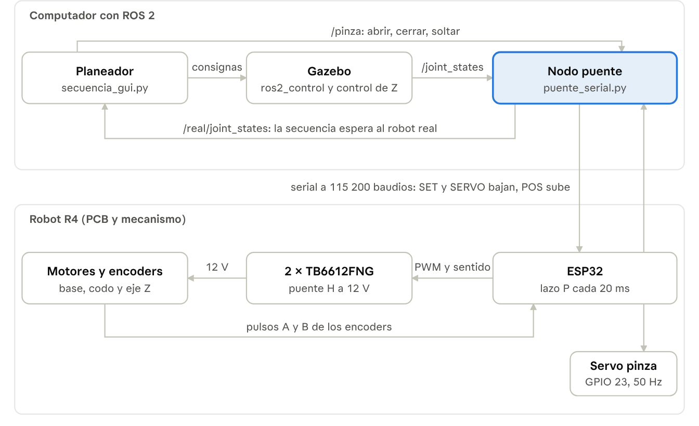
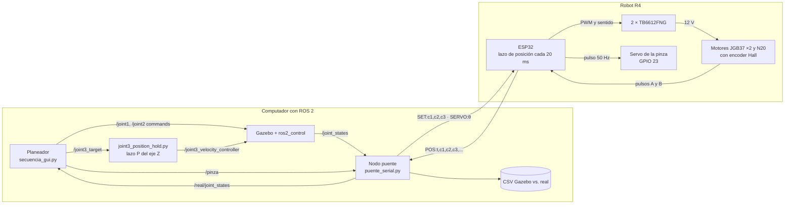
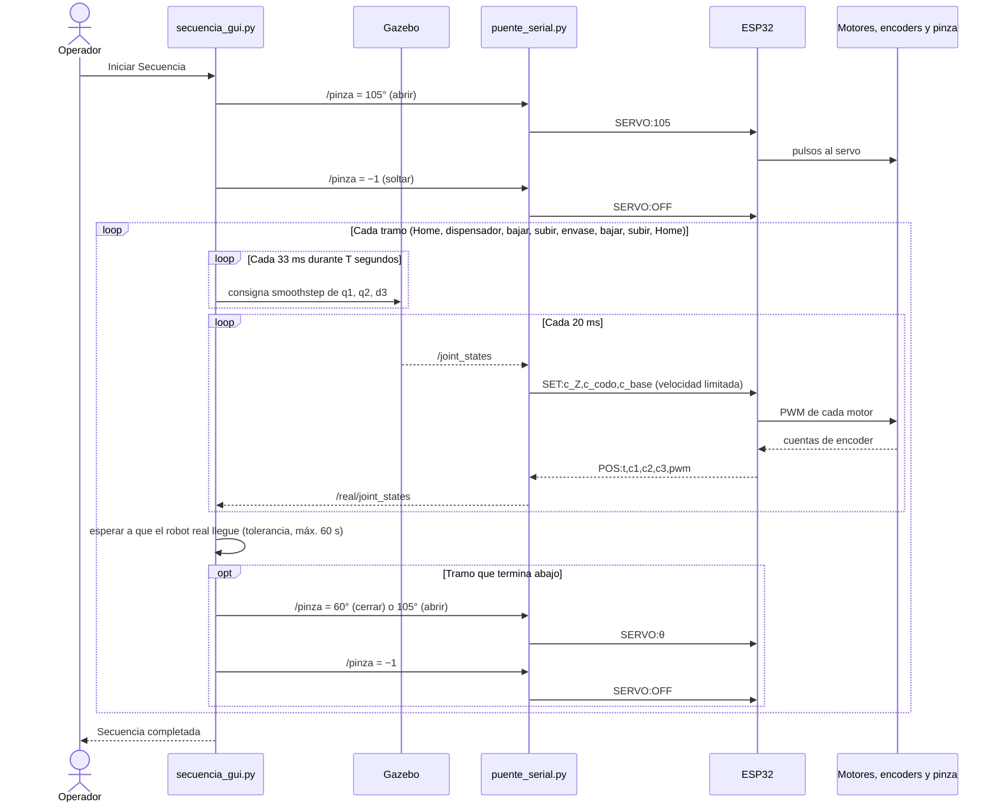
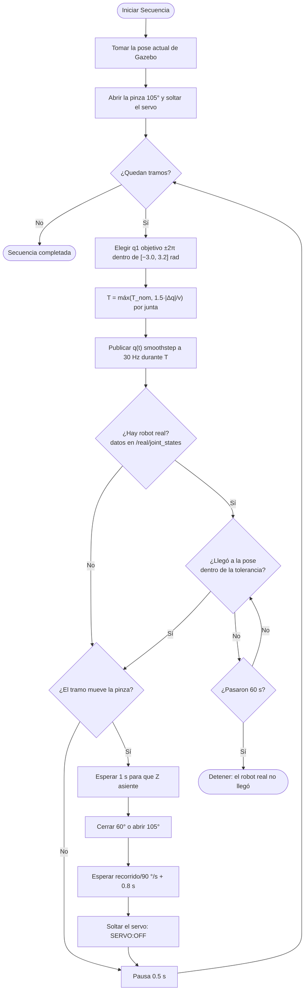
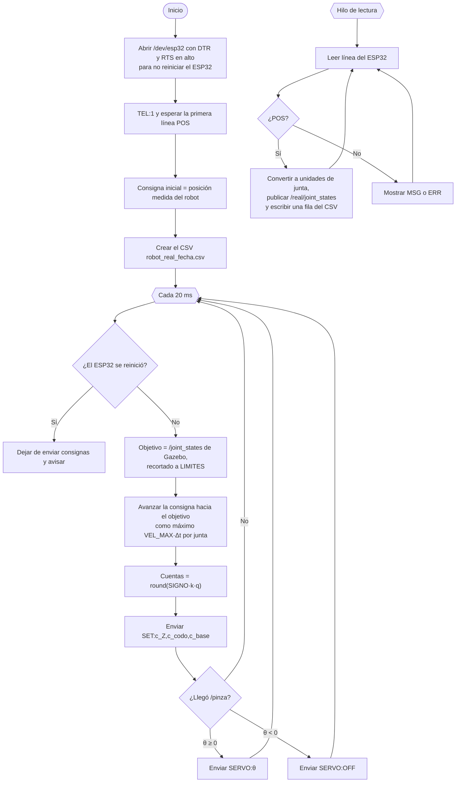
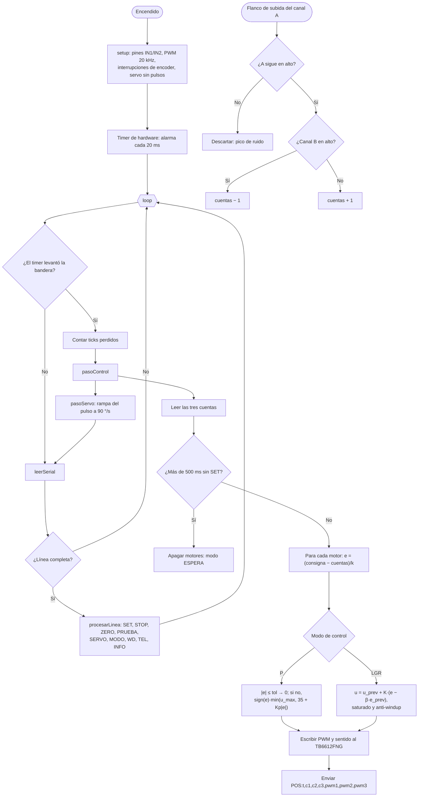

# Diagramas del SCARA R4

GitHub dibuja los diagramas de este archivo directamente (Mermaid). La imagen `arquitectura.png` es la misma Figura 6 de la cartilla.

1. [Arquitectura del sistema](#arquitectura-del-sistema)
2. [Diagrama de secuencia del proceso](#diagrama-de-secuencia-del-proceso)
3. [Diagrama de flujo de la secuencia (`secuencia_gui.py`)](#diagrama-de-flujo-de-la-secuencia)
4. [Diagrama de flujo del puente (`puente_serial.py`)](#diagrama-de-flujo-del-puente-serial)
5. [Diagrama de flujo del firmware del ESP32](#diagrama-de-flujo-del-firmware-del-esp32)

---

## Arquitectura del sistema

---

## Diagrama de secuencia del proceso

Un ciclo de colocación de tapa, con el robot real conectado.

---

## Diagrama de flujo de la secuencia

---

## Diagrama de flujo del puente serial

---

## Diagrama de flujo del firmware del ESP32

