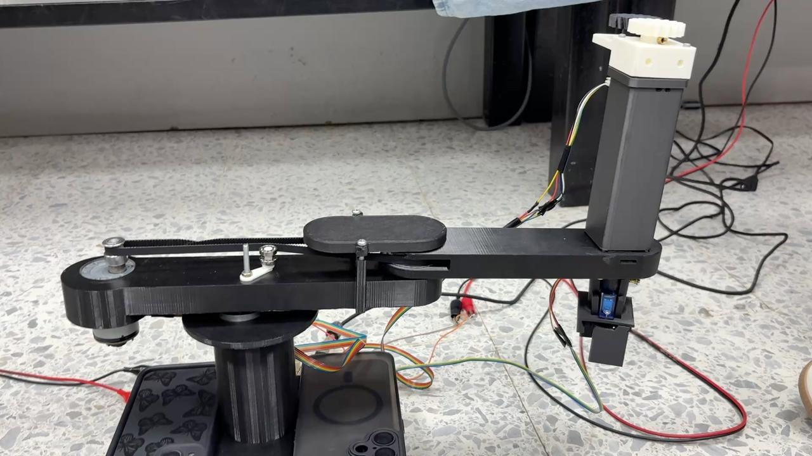
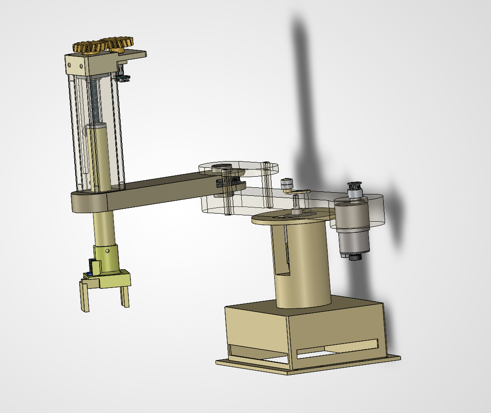
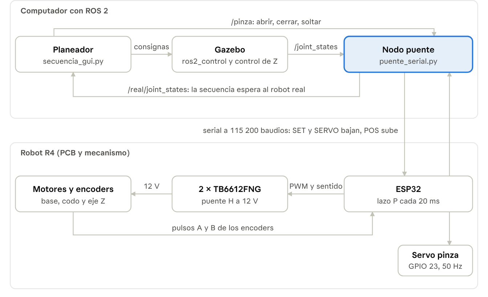
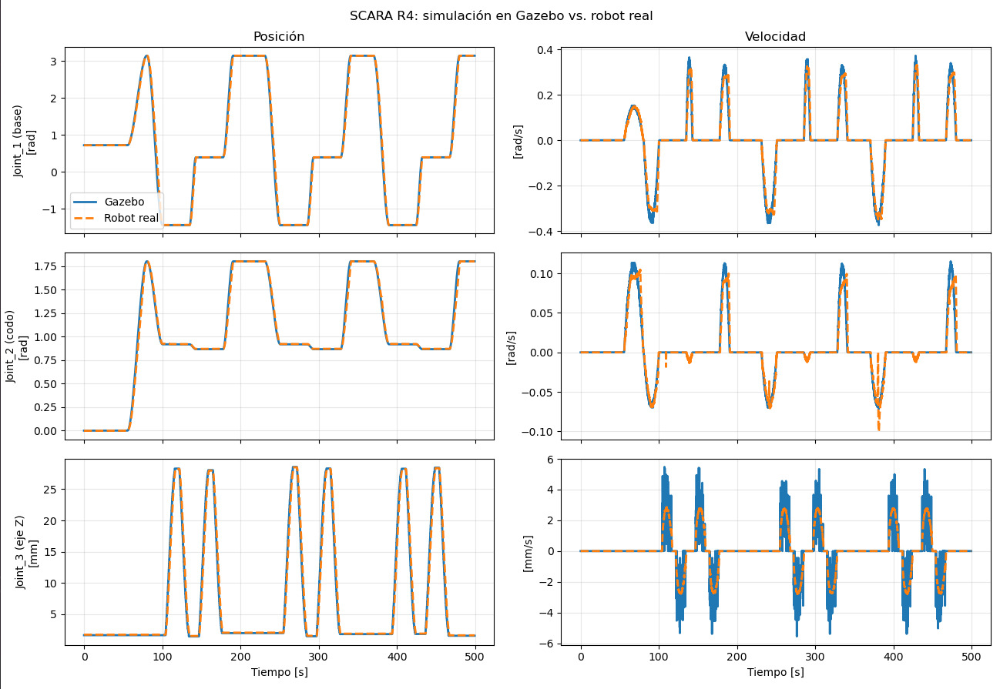

# 🤖 Robot 4 (SCARA R4): colocación de tapas en envases de aceite


Manipulador **SCARA de 3 grados de libertad (RRP) con pinza** que toma una tapa plástica de un dispensador y la coloca sobre la boca de un envase de aceite. El robot real **copia en tiempo real** al robot simulado en Gazebo: los mismos programas de ROS 2 mueven la simulación y el hardware.

Proyecto integrador del **Laboratorio de Robótica** (octavo semestre), Ingeniería Mecatrónica, Universidad Militar Nueva Granada.

**Integrantes:** Geraldine Suarez · Sergio Boada · Danna Poveda · Diego Burgos

| Entregable | Enlace |
|---|---|
| Cartilla técnica (entrega final) | [Documentos/Cartilla_SCARA_R4_Entrega_Final.pdf](Documentos/Cartilla_SCARA_R4_Entrega_Final.pdf) |
| Video del funcionamiento | [Google Drive](https://drive.google.com/file/d/1xr8ooY4bUz9gxodWNE3gWuyT3NXSXv7d/view?usp=sharing) |
| Instructivo de usuario | [Documentos/Instructivo_de_usuario.md](Documentos/Instructivo_de_usuario.md) |

<p align="center">
  
  
</p>
<p align="center"><i>El R4 construido (izquierda) y su modelo CAD con la pinza (derecha).</i></p>

---

## 📑 Contenido

1. [Contexto](#-contexto)
2. [Arquitectura del sistema](#-arquitectura-del-sistema)
3. [Estructura del repositorio](#-estructura-del-repositorio)
4. [Hardware](#-hardware)
5. [Modelo cinemático](#-modelo-cinemático)
6. [Control de bajo nivel](#-control-de-bajo-nivel)
7. [Instalación](#-instalación)
8. [Ejecución](#-ejecución)
9. [Resultados](#-resultados)
10. [Limitaciones y trabajo futuro](#-limitaciones-y-trabajo-futuro)

---

## 🏭 Contexto

En una línea de envasado de aceite, el sellado ocurre a altas temperaturas. Poner las tapas a mano expone al operario a riesgo térmico y a fatiga por movimientos repetitivos. El R4 es la estación que **coloca la tapa sobre el envase ya lleno**: un *pick-and-place* dentro de una celda de 1.25 m × 1.25 m, con el dispensador de tapas y el envase a cada lado del robot.

**¿Por qué un SCARA RRP?** Los dos ejes rotacionales son verticales y paralelos, así que la tapa se mantiene horizontal sin muñeca, y la junta prismática vertical da el descenso puro que pide el sellado. Resultado: tres actuadores y cinemática inversa en forma cerrada.

### Requisitos y restricciones (Guía 1)

| Requisito | Valor exigido | Valor en el R4 |
|---|---|---|
| Área de la celda | 1.25 m × 1.25 m | Alcance de 40 a 280 mm |
| Velocidad de las juntas rotacionales | ≤ 2 rad/s | ≤ 0.40 rad/s (base) y ≤ 0.12 rad/s (codo) enviados al robot |
| Velocidad de la junta prismática | ≤ 0.15 m/s | ≤ 3 mm/s enviados al robot |
| Actuación | Motores DC con reductor, sin servomotores en las juntas | Lazo de posición propio por motor en un ESP32 |
| Sujeción de la tapa | Tomar y soltar en puntos definidos | Pinza de dos posiciones con servomotor (105° abierta, 60° cerrada) |

---

## 🧩 Arquitectura del sistema



1. **Planeador** (`secuencia_gui.py`, `ik_gui_teleop.py`, `joint_angle_gui.py` o `trayectoria_lineal.py`): publica las consignas de las juntas.
2. **Gazebo + ros2_control**: mueve el robot simulado y publica su estado en `/joint_states`.
3. **Nodo puente** (`puente_serial.py`): lee `/joint_states`, limita la velocidad de cada junta, convierte a cuentas de encoder y las envía al ESP32 a 50 Hz. Publica la posición real en `/real/joint_states` y guarda un CSV con Gazebo vs. robot real.
4. **ESP32**: cierra el lazo de posición de los tres motores cada 20 ms y mueve el servo de la pinza.
5. **Sincronización**: la secuencia espera, al final de cada tramo, a que el robot real llegue a la pose.

Diagramas de secuencia y de flujo: [Documentos/Diagramas](Documentos/Diagramas/README.md).

---

## 📁 Estructura del repositorio

```
Robot_4/
├── README.md                      ← este archivo
├── brazo_solidworks/              ← paquete de ROS 2 (código fuente de alto nivel)
│   ├── CMakeLists.txt · package.xml
│   ├── config/controllers.yaml    ← controladores de ros2_control
│   ├── launch/                    ← gazebo.launch.py, display.launch.py
│   ├── meshes/ · urdf/            ← modelo exportado de SolidWorks
│   └── scripts/                   ← planeadores, puente serial, gráficas, regla udev
├── firmware_esp32/                ← proyecto PlatformIO del ESP32 (control de bajo nivel)
│   ├── platformio.ini
│   └── src/main.cpp
├── Documentos/                    ← cartilla, instructivo, memorias, diagramas, hojas de datos
└── Planos/
    ├── Electricos/                ← esquemático y PCB, con la tabla de pines verificada
    └── Mecanicos/                 ← planos de piezas y ensambles (SolidWorks)
```

Cada carpeta tiene su propio `README.md`.

---

## 🔌 Hardware

| Elemento | Componente | Detalle |
|---|---|---|
| Base (q₁) | Motorreductor JGB37-520, 12 V, 12 rpm, 810:1 | Encoder Hall de 11 pulsos/vuelta → 1418.1 cuentas/rad |
| Codo (q₂) | JGB37-520 + correa 20:60 (3:1) | 4254.2 cuentas/rad; el motor va detrás del eje de la base |
| Eje Z (d₃) | Motorreductor N20, 12 V, 30 rpm + husillo T8×8 | 875 cuentas/mm; máximo ≈ 4 mm/s |
| Pinza | Microservo de 50 Hz | GPIO 23 |
| Control | ESP32 + 2 × TB6612FNG en PCB propia | Fuente de 12 V; regulador L7805 para 5 V |

Pines y conectores verificados: [Planos/Electricos](Planos/Electricos/README.md).

---

## 📐 Modelo cinemático

L₁ = 120 mm, L₂ = 160 mm, altura de la base z₀ = 163 mm, carrera de Z de 0 a 105 mm.

| Junta | Tipo | θᵢ | dᵢ | aᵢ | αᵢ |
|---|---|---|---|---|---|
| 1 | Rotacional | q₁ | h | L₁ | 0° |
| 2 | Rotacional | q₂ | 0 | L₂ | 180° |
| 3 | Prismática | 0 | d₃ | 0 | 0° |

```
Directa:   x = L₁·cos q₁ + L₂·cos(q₁+q₂)
           y = L₁·sen q₁ + L₂·sen(q₁+q₂)
           z = z₀ − d₃
Inversa:   cos q₂ = (x² + y² − L₁² − L₂²) / (2·L₁·L₂)        (rama q₂ > 0)
           q₁ = atan2(y, x) − atan2(L₂·sen q₂, L₁ + L₂·cos q₂)
           d₃ = z₀ − z
Jacobiano: |J| = L₁·L₂·sen q₂   (singular con q₂ = 0° o 180°)
```

| Pose de la tarea | q₁ | q₂ | x [mm] | y [mm] | \|J\| / máximo |
|---|---|---|---|---|---|
| Home | 180.0° | 103.1° | −83.6 | −155.8 | 97 % |
| Dispensador de tapas | −82.7° | 52.6° | 153.7 | −199.2 | 79 % |
| Boca del envase | 22.4° | 49.6° | 160.3 | 197.9 | 76 % |

Desarrollo completo: [Documentos/Memorias_de_calculo.md](Documentos/Memorias_de_calculo.md).

---

## 🎛️ Control de bajo nivel

- **Diseño por LGR** sobre el modelo identificado G(s) = 0.046814 / (1 + 0.002554·s) (ajuste 83.53 %), con Ts = 20 ms:
  `u[k] = u[k−1] + 6.9327·(e[k] − 0.0435·e[k−1])`. Implementado en el firmware (`MODO:LGR`).
- **Control usado en el robot real**: proporcional con compensación de zona muerta,
  `u = sign(e)·min(u_max, 35 + Kp·|e|)` si |e| > e_tol, con Kp = 400 PWM/rad (base), 1200 PWM/rad (codo) y 80 PWM/mm (Z).
- **Seguridad**: watchdog de 500 ms (sin consignas, los motores se apagan) y límite de PWM 120 en base y codo. Las protecciones de atasco y de error grande están en el código, desactivadas en la versión final.

Detalles: [firmware_esp32/README.md](firmware_esp32/README.md).

---

## ⚙️ Instalación

```bash
# 1. Dependencias (ROS 2 Lyrical ya instalado)
sudo apt install ros-lyrical-ros-gz ros-lyrical-gz-ros2-control ros-lyrical-ros2-controllers \
                 python3-serial python3-numpy python3-matplotlib python3-tk

# 2. Paquete en el workspace
git clone https://github.com/estryneestupinan-ux/Lab-Robotica.git
mkdir -p ~/ros2_ws/src
cp -r Lab-Robotica/Robot_4/brazo_solidworks ~/ros2_ws/src/
cd ~/ros2_ws && colcon build --packages-select brazo_solidworks && source install/setup.bash

# 3. Nombre fijo para el puerto del ESP32 (solo si se usa el robot real)
sudo cp ~/ros2_ws/src/brazo_solidworks/scripts/99-esp32.rules /etc/udev/rules.d/
sudo udevadm control --reload-rules && sudo udevadm trigger

# 4. Firmware (solo la primera vez o si cambia main.cpp)
cd Lab-Robotica/Robot_4/firmware_esp32 && pio run -t upload
```

---

## 🚀 Ejecución

### Solo simulación

```bash
# Terminal 1
source ~/ros2_ws/install/setup.bash
ros2 launch brazo_solidworks gazebo.launch.py
# Terminal 2
source ~/ros2_ws/install/setup.bash
python3 ~/ros2_ws/src/brazo_solidworks/scripts/joint3_position_hold.py
# Terminal 3
source ~/ros2_ws/install/setup.bash
python3 ~/ros2_ws/src/brazo_solidworks/scripts/secuencia_gui.py
```

Sin `puente_serial.py`, la secuencia no espera al robot real y solo mueve Gazebo.

### Con el robot real

Igual que arriba, más el puente en otra terminal **antes** de abrir la secuencia:

```bash
source ~/ros2_ws/install/setup.bash
cd ~/ros2_ws/src/brazo_solidworks/scripts
python3 puente_serial.py
```

Antes hay que llevar el robot a la pose cero (brazo extendido, Z arriba) y mandar `ZERO` al ESP32. El paso a paso, con las verificaciones y la solución de problemas, está en el [instructivo de usuario](Documentos/Instructivo_de_usuario.md). Para detener el robot real en cualquier momento: **Ctrl+C en la terminal del puente**.

Al terminar, `python3 graficar_comparacion.py` grafica Gazebo vs. robot real a partir del CSV del puente.

---

## 📊 Resultados



*Posición (izquierda) y velocidad (derecha) de la base, el codo y el eje Z en Gazebo (continua) y en el robot real (discontinua) durante tres ciclos de la tarea.*

| Indicador | Resultado |
|---|---|
| Calibración | 90° exactos en base y codo; cada paso de 10 mm en Z midió 10 mm |
| Seguimiento de Gazebo | Posiciones superpuestas en las tres juntas durante tres ciclos (~500 s) |
| Velocidad pico real | Base 0.30–0.33 rad/s (Gazebo 0.36); codo ~0.10 rad/s (Gazebo 0.11); Z ~2.8 mm/s |
| Tarea completa | **9 de 10 ejecuciones exitosas**; ~110 s por ciclo de Home a Home |
| Modelo cinemático | Error máximo de 0.017 mm al reconstruir la recta de validación |

---

## ⚠️ Limitaciones y trabajo futuro

- **Interferencia del servo**: mientras el servo recibe pulsos, los encoders dejan de contar. La secuencia suelta el servo (`SERVO:OFF`) después de abrir o cerrar; la causa de fondo (tierras, cableado) sigue pendiente.
- **GPIO 12**: el canal A del encoder de la base está en un pin de arranque del ESP32; si queda en alto al encender, el ESP32 no arranca. Solución definitiva: fijar el voltaje de la flash por eFuse o mover ese canal al GPIO 18.
- **Holgura del eje Z** de 3 a 5 mm al invertir el sentido, y **pinza en lazo abierto** (el intento fallido no se detectó).
- **Protecciones de atasco y de error grande desactivadas**; la parada depende del watchdog o del operador.
- El controlador LGR no se validó en el robot real.

---

*Universidad Militar Nueva Granada · Facultad de Ingeniería · Ingeniería Mecatrónica · Laboratorio de Robótica · 2026*
